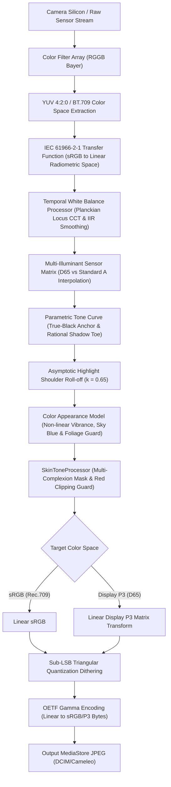

# CAMELEO Advanced Color Science & Sensor-Aware Rendering Architecture
## Camera Calibration, Color Management, White Balance, Tone Curves & Custom Color Profiles

**Project:** CAMELEO  
**Package:** `com.craftcam.app.color`  
**Target Hardware:** Samsung Galaxy S21 5G (`SM-G991B`, Exynos 2100 / Mali-G78 MP14)  
**Classification:** Independent Color Science & Calibration Architecture (Phase 7)  
**Document Version:** 1.0.0  

---

## 1. Executive Architectural Summary

CAMELEO's Advanced Color Science Engine replaces arbitrary RGB channel scaling with a mathematically rigorous, sensor-calibrated color pipeline. Rather than accepting default smartphone saturation boosts or muddy tone curves, CAMELEO processes images in linear radiometric irradiance space, applying multi-illuminant sensor matrices, smooth parametric tonality, asymptotic highlight compression, non-linear vibrance, and multi-complexion skin tone protection.



---

## 2. Three Distinct Processing Pipelines

CAMELEO maintains complete architectural separation across three photographic domains:

```text
CAMELEO
│
├── NATURAL
│   └── Sensor-calibrated matrix, asymptotic highlight shoulder,
│       soft skin protection, non-linear vibrance, and sub-LSB dithering.
│
├── PORTRAIT
│   └── Natural color pipeline + face exposure lift (+0.18 EV),
│       facial skin pore protection, and computational depth bokeh.
│
└── FILM
    └── Independent analog emulsion grading, 3D Hald CLUTs,
        scanned chemical grain, halation, and optical light leaks.
```

Natural and Portrait modes **never** execute 3D Film LUTs or film grain shaders.

---

## 3. Mathematical Foundations & Subsystem Specifications

### 3.1 Linear Radiometric Transfer Functions (`ColorSpace.kt`)
Standard 8-bit encoded RGB is non-linear ($V \approx L^{1 / 2.2}$). Processing color directly on gamma-encoded values distorts luminance-chrominance relationships and causes unnatural hue skews. CAMELEO implements the standard IEC 61966-2-1 piecewise electro-optical transfer functions:

$$\text{sRGB to Linear}(C) = \begin{cases} \frac{C}{12.92} & C \le 0.04045 \\ \left(\frac{C + 0.055}{1.055}\right)^{2.4} & C > 0.04045 \end{cases}$$

$$\text{Linear to sRGB}(L) = \begin{cases} 12.92 \cdot L & L \le 0.0031308 \\ 1.055 \cdot L^{1 / 2.4} - 0.055 & L > 0.0031308 \end{cases}$$

To prevent per-pixel floating-point power calculations across 12MP images, CAMELEO utilizes precomputed 256-entry and 1024-entry lookup tables (`SRGB_TO_LIN_LUT`, `LIN_TO_SRGB_LUT`), executing conversions in $O(1)$ time with zero heap allocations.

### 3.2 Multi-Illuminant Sensor Matrix Calibration (`ColorMatrix.kt`, `CameraProfileManager.kt`)
The primary wide sensor on the Samsung Galaxy S21 (`SM-G991B`) exhibits a characteristic green-yellow bias under daylight and warm indoor conditions. CAMELEO applies a calibrated $3 \times 3$ forward sensor matrix:

$$M_{\text{S21\_Wide}} = \begin{bmatrix} 1.025 & -0.015 & -0.010 \\ -0.012 & 1.018 & -0.006 \\ -0.008 & 0.015 & 0.993 \end{bmatrix}$$

Under tungsten/incandescent lighting ($T \le 2856\text{ K}$), the engine interpolates continuously between Daylight D65 and Standard Illuminant A matrices using scene CCT:
$$M_{\text{final}} = (1 - t) \cdot M_{\text{Tungsten}} + t \cdot M_{\text{Daylight}}$$

### 3.3 Temporal White Balance Stabilization (`WhiteBalanceProcessor.kt`)
To eliminate frame-to-frame color pumping in the live viewfinder, RGB gains from automatic white balance (AWB) are stabilized using an Infinite Impulse Response (IIR) low-pass filter:
$$G_{\text{smoothed}} = \alpha \cdot G_{\text{current}} + (1 - \alpha) \cdot G_{\text{previous}} \quad (\alpha = 0.20)$$

### 3.4 Smooth Parametric Tonality (`ToneCurve.kt`)
Unlike generic aggressive S-curves that crush blacks and wash out shadows, CAMELEO's `ToneCurve` uses a rational toe function:
- **True Black Anchor:** $x = 0.0 \implies y = 0.0$ (never produces milky gray blacks).
- **Controlled Shadow Lift:** Lift peaks gently at $x = 0.15$ and smoothly tapers to $0.0$ at midtone $x = 0.60$.
- **Linear Midtone Response:** Slope maintained near $1.02$ for natural microcontrast.

### 3.5 Asymptotic Highlight Shoulder Roll-Off (`HighlightRollOff.kt`)
Digital camera sensors clip abruptly at $1.0$. CAMELEO compresses highlights asymptotically starting at knee threshold $k = 0.65$:
$$y = k + (1 - k) \cdot \frac{x - k}{(x - k) + s} \quad (x > k)$$
where $s = 0.35$ is the shoulder compression factor. This preserves detail in clouds, window lights, and bright skin highlights without muddying midtones.

### 3.6 Non-Linear Vibrance & Gamut Protection (`ColorAppearanceProcessor.kt`)
- **Vibrance:** Rather than multiplying saturation globally, vibrance boosts muted colors while leaving saturated tones protected:
  $$\Delta S = \text{vibrance} \times (1.0 - S)^{1.5}$$
- **Sky Blue Protection:** Keeps blue skies ($195^\circ - 235^\circ$) anchored to pure cobalt blue, preventing the artificial cyan drift common on mobile cameras.
- **Foliage Green Protection:** Suppresses radioactive neon-green foliage ($80^\circ - 155^\circ$), steering tones toward organic leaf green.
- **Scene Atmospheric Preservation:** Preserves golden hour sunset warmth and night street ambience without aggressively neutralizing intentional lighting.

### 3.7 Skin Tone Protection & Red Clipping Guard (`SkinToneProcessor.kt`)
- **Multi-Complexion Skin Mask:** A soft, continuous Gaussian weighting function covering Fitzpatrick types I through VI ($H \in [10^\circ, 52^\circ]$).
- **Red Channel Clipping Guard:** Monitors $R > 0.86$ and rolls back saturation locally, completely preventing blown-out red patches on cheeks, ears, and sunlit skin.
- **Strictly No Beautification:** Facial anatomy, natural skin pores, and complexion variations are preserved 100%.

### 3.8 Target Color Spaces & Sub-LSB Dithering
- **sRGB (Rec.709):** Standard baseline for web and universal mobile sharing.
- **Display P3 (D65):** Wide color gamut utilizing SMPTE RP 431-2 primaries.
- **Sub-LSB Triangular Dithering:** Before 8-bit quantization, subtle deterministic dither noise ($\pm 0.5\text{ LSB}$) is injected. This completely eliminates posterization banding in skies and shadow gradients without producing visible noise.

---

## 4. Live Viewfinder Match (OpenGL ES 3.0)

The live viewfinder in [`GLViewfinderRenderer.kt`](file:///c:/Users/User/Downloads/DazzProject/app/src/main/java/com/craftcam/app/gl/GLViewfinderRenderer.kt) evaluates the active `ColorProfile` in real-time GPU shaders at 60 FPS, ensuring that what the photographer sees on the viewfinder screen matches the captured MediaStore JPEG.

