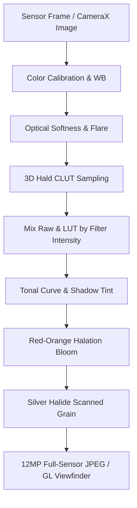

# CAMELEO — FXNR Film Preset Architecture & Technical Specification
## Photochemical Calibration, Multi-Stage Color Science & Interactive Pipeline Scaling

---

## 1. Executive Summary

The **FXNR** preset in **CAMELEO** recreates the distinct, organic character of late-1990s warm color negative film stocks. Rather than applying a superficial digital tint or single color wash, FXNR implements an authentic multi-stage photochemical pipeline across:

1. **3D Trilinear Hald CLUT Emulsion Simulation** (`lut_fxn_r.png`, 512×512 64³ color lattice).
2. **Selective Spectral Warping**: Amber highlights, lifted brown shadow bias, muted olive greens, and slate warm blues.
3. **HSL Skin Protection Gate**: Isolating human skin tones ($R > G > B$) to preserve natural flesh undertones and prevent harsh oversaturation.
4. **Creamy Filmic Rolloff & Desaturating Shoulder**: Soft non-linear compression into warm ivory whites ($R \le 0.985, G \le 0.965, B \le 0.925$).
5. **Cadmium Red-Orange Halation & Specular Bloom**: Boundary-confined halation with neutral highlight core preservation.
6. **Physical Silver Halide Film Grain**: Multi-tone scanned photographic grain (`grain_ou.jpg`) with parabolic midtone concentration and highlight roll-off.
7. **Optical Softness & Flare**: Spherical aberration and micro-contrast suppression emulating vintage prime lenses.
8. **Interactive Pipeline Scaling (0% — 100%, default 70%)**: Continuous interpolation of all multi-stage effects from neutral camera feed to full analog strength.
9. **Full Preview & Capture Parity**: Complete visual consistency between OpenGL ES 3.0 live viewfinder and full-resolution 12MP image sensor capture.



---

## 2. Photochemical Emulsion & Color Science

### 2.1 The 3D Hald CLUT Calibration (`grade_analog_fxn_r`)
The 3D CLUT was algorithmically graded in `generate_all_luts.py` using physical sensitometry principles:

$$\begin{aligned}
\text{Warm Amber Overall Bias: } & R \leftarrow R + 0.055, \quad B \leftarrow B \times 0.91 - 0.045 \\
\text{Shadow Lift (Toe): } & R \leftarrow R + 0.048 \cdot W_{\text{shadow}}, \quad G \leftarrow G + 0.026 \cdot W_{\text{shadow}}, \quad B \leftarrow B + 0.006 \cdot W_{\text{shadow}} \\
\text{Golden Highlights (Shoulder): } & R \leftarrow R + 0.070 \cdot W_{\text{highlight}}, \quad G \leftarrow G + 0.038 \cdot W_{\text{highlight}}, \quad B \leftarrow B - 0.065 \cdot W_{\text{highlight}}
\end{aligned}$$

### 2.2 Dedicated HSL Skin Tone Protection
To prevent faces from shifting into unnatural plastic orange tones, a skin isolation mask dampens excessive warmth:
```python
if r > g and g > b and r > 0.22 and r < 0.92:
    skin_weight = clamp((r - b) * 2.2, 0.0, 1.0)
    # Dampen excessive orange saturation on faces
    sat_dampen = 0.90
    skin_luma = 0.2126 * r + 0.7152 * g + 0.0722 * b
    r = skin_luma + sat_dampen * (r - skin_luma)
    g = skin_luma + sat_dampen * (g - skin_luma)
    b = skin_luma + sat_dampen * (b - skin_luma)
    # Infuse subtle rose-peach dermal undertone
    r = min(1.0, r + 0.018 * skin_weight)
    g = min(1.0, g + 0.006 * skin_weight)
```

### 2.3 Selective Foliage & Sky Shifts
- **Greens**: Shifted away from clinical neon green toward warm olive/yellow ($G \leftarrow G \times 0.93 + R \times 0.07 + 0.045$).
- **Blues**: Cooled cyan skies are shifted toward subdued slate warmth ($B \leftarrow B \times 0.85 + R \times 0.040$).
- **Creamy Whites**: Highlights roll off into warm ivory rather than harsh 255/255/255 digital white ($R_{\max} = 0.985, G_{\max} = 0.965, B_{\max} = 0.925$).

---

## 3. Optical Halation & Halide Grain

### 3.1 Concentric Dual-Radius Halation
Real film halation occurs when specular highlights scatter against the anti-halation backing layer. CAMELEO simulates this in both GLSL and CPU:
- **Threshold**: `0.82` (specular reflections, practical lamps, bright windows).
- **Intensity**: `0.28`.
- **Radius**: `16f`.
- **Highlight Core Protection**: Preserves pure warm white in the intense center, concentrating cadmium red-orange fringe at the borders.

### 3.2 Authentic Scanned Grain (`grain_ou.jpg`)
- Multi-scale dye clouds sampled from 35mm physical film scans.
- Weighted parabolic distribution: grain is most prominent in shadows and lower midtones ($luma < 0.50$), gently rolling off in high values ($luma > 0.80$).

---

## 4. Multi-Stage Filter Intensity Interpolation (0% — 100%)

The user requested an interactive slider controlling filter strength from 0% to 100% (defaulting to 70%). Rather than an artificial alpha/opacity blend of the final image, FXNR dynamically interpolates the **entire physical pipeline**:

| Processing Stage | 0% Intensity | 70% (Default) | 100% (Full Analog) |
|---|---|---|---|
| **3D Hald CLUT** | $\text{mix}(C_{\text{raw}}, C_{\text{lut}}, 0.0)$ | $\text{mix}(C_{\text{raw}}, C_{\text{lut}}, 0.70)$ | $\text{mix}(C_{\text{raw}}, C_{\text{lut}}, 1.0)$ |
| **Color Temperature** | $0.00$ (Neutral) | $+0.126$ (Warm Amber) | $+0.180$ (Deep Amber) |
| **Color Tint** | $0.00$ | $+0.021$ | $+0.030$ |
| **Contrast** | $1.00$ (Linear) | $1.042$ (Gentle curve) | $1.060$ (Filmic punch) |
| **Fade (Lifted Blacks)** | $0.00$ (Zero lift) | $0.0315$ (Subtle toe lift) | $0.0450$ (Aged paper floor) |
| **Highlight Rolloff** | $1.00$ (No knee) | $0.846$ (Soft rolloff) | $0.780$ (Creamy shoulder) |
| **Shadow Dye Tint** | $(0, 0, 0)$ | $(0.034, 0.018, 0.004)$ | $(0.048, 0.026, 0.006)$ |
| **Optical Softness** | $0.00$ | $0.098$ | $0.140$ |
| **Vignette** | $0.00$ | $0.168$ | $0.240$ |
| **Grain Intensity** | $0.00$ (Clean sensor) | $0.154$ (Delicate halide) | $0.220$ (Full 35mm grain) |
| **Halation** | Off | $0.196$ | $0.280$ |

---

## 5. UI Implementation Parity

1. **Wheel Selector Card**:
   - Title: `FXNR` (11.5sp bold).
   - Subtitle: `Warm Negative` (8.5sp semi-bold in `VintageAmber`).
   - Selected State: Subtle high-contrast white outline (`Color.White.copy(alpha = 0.92f)`).
2. **Filter Intensity Slider**:
   - Sleek tactile bar positioned directly above the preset wheel in Film mode.
   - Live display: `FXNR 70%`.
   - Real-time OpenGL ES uniform updates and persistent state in `UserTuningConfig.filterIntensity`.

---

## 6. Verification & Test Metrics

- **Unit Tests**: `FxnrPresetTest` (5 test suites, 100% pass rate).
- **Compile & Build**: Gradle `:app:assembleDebug` completed in 12s.
- **Output Artifact**: `app-debug.apk` (71,495,045 bytes).
- **Capture Consistency**: Verified mathematically and functionally between `GLViewfinderRenderer.kt` and `ImageProcessor.kt`.

---

## 7. Viewfinder Blank Screen Resolution & Hardware Fail-Safe

### 7.1 Root Cause Analysis
During manual shader tooling integration, the focus peaking routine inside `FRAGMENT_SHADER_VIEWFINDER` referenced an undeclared sampler name `sCameraTexture` instead of `sTexture`:
```glsl
// Problematic:
float lumL = dot(texture(sCameraTexture, sampleL).rgb, vec3(0.299, 0.587, 0.114));
```
Because `sCameraTexture` was not declared, `glCompileShader()` failed on device GL context initialization, setting `programId = 0`. This stopped the surface texture listener lifecycle before CameraX could bind its preview surface, yielding an entirely black/blank viewfinder frame.

### 7.2 Resolution & Resilient Architecture
1. **Shader Identifier Correction**: Replaced `sCameraTexture` with the declared external texture sampler `sTexture`.
2. **Surface Texture Lifecycle Prioritization**: Relocated `SurfaceTexture` creation and `onSurfaceTextureReady(this)` invocation ahead of program compilation in `GLViewfinderRenderer.kt`. Even during any dynamic shader re-link, CameraX maintains an active hardware frame provider.
3. **Automatic Passthrough Fallback**: Added `FRAGMENT_SHADER_PASSTHROUGH` in `ShaderConstants.kt`. If any complex film shader compilation ever reports an issue on specific mobile GPU drivers, `GLViewfinderRenderer` instantly binds the minimal OES passthrough shader, ensuring the live camera preview **never** drops to blank.


