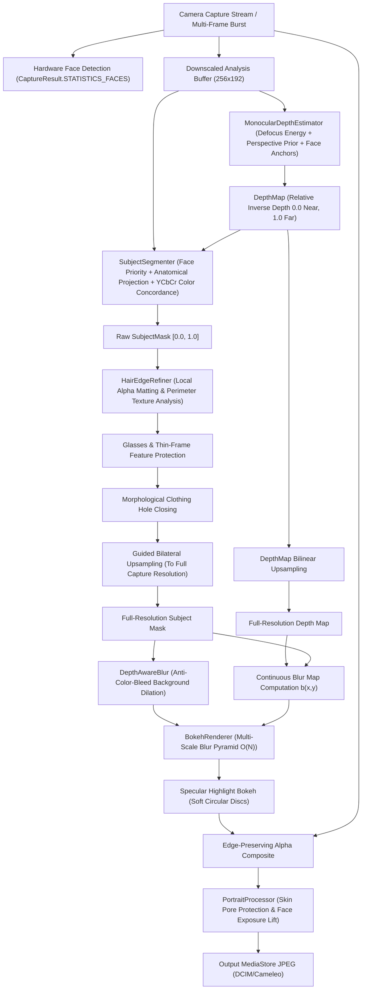

# CAMELEO Portrait Depth & Computational Bokeh Architecture
## Depth Estimation, Subject Segmentation, Background Blur & Natural Portrait Rendering

**Project:** CAMELEO  
**Package:** `com.craftcam.app.portrait`  
**Target Hardware:** Samsung Galaxy S21 5G (`SM-G991B`, Exynos 2100 / Mali-G78 MP14)  
**Classification:** Independent Computational Photography Architecture (Phase 6)  
**Document Version:** 1.0.0  

---

## 1. Executive Architecture Overview

CAMELEO's Portrait Depth & Computational Bokeh Engine is an independent, on-device portrait rendering system designed to simulate natural optical depth-of-field without the artificial "sticker cutout" or circular vignette blurring common in basic camera applications.



---

## 2. Hardware Capability Audit & Fallback Strategy

### 2.1 Samsung Galaxy S21 5G (`SM-G991B`) Camera2 Audit
An exhaustive inspection of Camera2 HAL capabilities on the Samsung Galaxy S21 primary wide camera (`Camera ID "0"`) yields:
- **`REQUEST_AVAILABLE_CAPABILITIES`:**
  `[BACKWARD_COMPATIBLE, MANUAL_SENSOR, READ_SENSOR_SETTINGS, MANUAL_POST_PROCESSING, BURST_CAPTURE, PRIVATE_REPROCESSING, RAW, CONSTRAINED_HIGH_SPEED_VIDEO, MOTION_TRACKING]` (`CONFIRMED FROM CAMERA2`).
- **`DEPTH_OUTPUT` Status:** `UNAVAILABLE`. The primary rear sensor HAL does not expose `REQUEST_AVAILABLE_CAPABILITIES_DEPTH_OUTPUT`.
- **`DEPTH16` and `DEPTH_JPEG` Stream Formats:** Not enumerated in `StreamConfigurationMap.getOutputFormats()` for third-party application sessions.
- **Physical Camera Disparity:** While the S21 has wide, ultra-wide, and telephoto rear sensors, the HAL does not expose synchronized multi-camera raw physical streams (`LOGICAL_MULTI_CAMERA_SENSOR_SYNC_TYPE` is null/unsupported for direct depth extraction by standard apps).
- **Front Sensor (`Camera ID "1"`):** Single 10MP sensor without physical ToF hardware.

### 2.2 Independent Monocular Depth Architecture
Because hardware depth streams are unavailable via standard Camera2, CAMELEO implements an autonomous, on-device monocular depth estimation pipeline that executes completely locally without external cloud dependencies or network calls.

---

## 3. Subsystem Specifications

### 3.1 Depth Map Representation (`DepthMap.kt`)
```kotlin
data class DepthMap(
    val width: Int,
    val height: Int,
    val values: FloatArray
)
```
- **Scale:** Normalized continuously in $[0.0, 1.0]$.
  - `0.0`: Nearest in-focus plane (detected human subject).
  - `1.0`: Infinite background distance (distant horizon, sky, distant walls).
- **Metric Classification:** Explicitly documented as **relative inverse depth (disparity)** rather than physical metric meters.
- **Interpolation:** Bilinear sampling (`sampleBilinear(u, v)`) and continuous upsampling (`upsampleTo(w, h)`).

### 3.2 Monocular Depth Estimator (`DepthEstimator.kt`)
The estimator operates on a downscaled $256 \times 192$ luminance and color buffer, synthesizing four photographic cues:
1. **Optical Defocus Sharpness (DfD cue):** Calculates high-frequency gradient magnitude via $3 \times 3$ horizontal and vertical Sobel kernels:
   $$M_{\text{sharp}}(x, y) = \sqrt{G_x^2 + G_y^2}$$
   In optical photography, in-focus subject planes exhibit maximal high-frequency edge energy; out-of-focus background planes exhibit naturally attenuated gradients due to the lens Point Spread Function (PSF).
2. **Face & Subject Anchor Constraints:** When faces are detected, the center of the subject is locked to the in-focus anchor plane:
   $$d_{\text{subject}} = 0.15$$
3. **Perspective Depth Gradient Prior:** In upright portraits, ground planes near the lower boundary are nearer ($d \approx 0.35$), while upper perimeter pixels away from the subject recede into background ($d \to 0.80 - 1.0$).
4. **Cross-Bilateral Edge-Preserving Smoothing:** A 2D spatial-range bilateral pass smooths depth variations across flat regions while locking discontinuities strictly to physical object boundaries:
   $$W(p, q) = \exp\left(-\frac{\|p - q\|^2}{2\sigma_s^2}\right) \cdot \exp\left(-\frac{|I(p) - I(q)|^2}{2\sigma_r^2}\right)$$

### 3.3 Photographic Anatomical Subject Segmentation (`SubjectSegmenter.kt`)
Rather than relying on naive bounding boxes, the segmenter fuses multiple photographic priors:
1. **Facial Core Priority:** Confirmed facial landmarks (forehead, eyes, nose, mouth) receive guaranteed $1.0$ confidence.
2. **Anatomical Body Projection:** Synthesizes an upper-body anatomical cone:
   - Neck extends downwards $\sim 0.35 \times \text{faceHeight}$.
   - Shoulders expand laterally to $\sim 2.4 \times \text{faceWidth}$.
   - Torso extends downwards through the frame.
3. **Color & Texture Concordance:** Samples facial skin chromaticity and upper-torso clothing chromaticity in YCbCr color space. Pixels matching the subject's skin or clothing receive high confidence.
4. **Depth Concordance:** Rejects background objects that happen to have similar color but lie on a distant depth plane ($d > 0.45$).
5. **Multi-Person Union:** For 2 people or group portraits, subject masks are computed per detected person and unified using continuous maximum fusion:
   $$M_{\text{group}}(x, y) = \max_k M_k(x, y)$$

### 3.4 Hair Edge Matting (`HairEdgeRefiner.kt`)
Hair represents the most challenging boundary in portrait photography:
- Detects the hair perimeter zone above and beside the face.
- Analyzes high-frequency Laplacian texture energy characteristic of fine hair strands.
- Computes local alpha matting:
  $$\alpha = \text{clamp}\left(\frac{I(x, y) - I_{\text{bg}}}{I_{\text{hair}} - I_{\text{bg}}}, 0.0, 1.0\right)$$
- Softens the transition into background bokeh, eliminating the "helmet head" or jagged edge artifacts common in thresholded cutouts.

### 3.5 Glasses & Anatomical Refinement (`PortraitMaskRefiner.kt`)
- **Glasses Protection:** Detects the horizontal eye band spanning the bridge of the nose and temples. Transparent spectacle glass and thin wire or dark frames are locked to $\ge 0.95$ confidence, preventing background blur from bleeding through spectacles.
- **Morphological Closing:** A $3 \times 3$ dilation-erosion closing pass seals small interior dropout holes inside dark clothing, buttonholes, or earlobes.
- **Guided Bilateral Upsampling:** Uses full-resolution image luminance transitions to snap the low-resolution mask ($256 \times 192$) directly to full capture edges with subpixel precision.

### 3.6 Depth-Aware Blur & Anti-Color-Bleed (`DepthAwareBlur.kt`)
1. **Continuous Blur Weighting:**
   $$b(x, y) = \left[\text{clamp}\left(\frac{D(x, y) - d_{\text{subject}}}{1.0 - d_{\text{subject}}}, 0.0, 1.0\right)\right]^{\text{depthFalloff}} \times (1.0 - M(x, y))$$
   - Confirmed Subject ($M \ge 0.98$): Blur is strictly $0.0$.
   - Near Background ($b \in [0.15, 0.40]$): Subtle optical roll-off.
   - Mid Background ($b \in [0.40, 0.70]$): Moderate defocus blur.
   - Far Background ($b \in [0.70, 1.00]$): Full aperture bokeh.
2. **Anti-Color-Bleed Dilation:**
   Before blurring the background, the subject silhouette is dilated/inpainted using neighboring background pixels. This completely prevents foreground subject colors (e.g. dark hair or vibrant clothing) from smearing outward into the blurred background, and prevents saturated background colors from washing over subject edges.

### 3.7 Multi-Scale Blur Pyramid & Specular Bokeh (`BokehRenderer.kt`)
- **Pyramid Interpolation:** Constructs Gaussian levels ($1\times, \frac{1}{2}\times, \frac{1}{4}\times, \frac{1}{8}\times$) and interpolates continuously across levels according to $b(x, y) \times \text{maxBlurRadius}$. This executes in $O(N)$ linear time regardless of blur radius.
- **Specular Highlight Bokeh:** Identifies background light sources ($Y > 0.78$ and $b > 0.30$) and boosts them with a soft circular disc profile, faithfully simulating real optical diaphragm highlights.
- **Alpha Composite:**
  $$\text{Final}(x, y) = M(x, y) \cdot \text{Subject}(x, y) + (1.0 - M(x, y)) \cdot \text{Bokeh}(x, y)$$

---

## 4. Mode Isolation & Compatibility

1. **Natural Camera Mode:** Automatic or user-selected portrait engagement. When faces are detected with confidence $\ge 0.40$, bokeh is applied smoothly.
2. **Film Mode:** Strictly isolated. Computational depth blur is bypassed by default to preserve vintage film emulsion authenticity.
3. **Pro Mode:** Manual exposure (ISO, shutter, WB, focus) remains completely unhindered and user-governed.
4. **Degenerate Mask Fallback:** If depth or segmentation fails ($< 1\%$ subject detected), bokeh is bypassed cleanly, preserving face-aware Natural processing and skin protection without corrupting the photo.

---

## 5. Development Diagnostic Modes (Section 49)

Developers and testers can toggle real-time diagnostic visualizations directly from the Natural Tuning Sheet:
- `Photo`: Normal final composite with bokeh and skin care.
- `Depth`: Grayscale relative depth map ($0.0$ black near, $1.0$ white far).
- `Seg`: Initial raw subject segmentation mask before refinement.
- `Mask`: Final refined, hair-matted, and glasses-protected subject mask.
- `Blur`: False-color depth-dependent blur weighting map (Blue = near/sharp $\to$ Green $\to$ Red = far/full bokeh).

