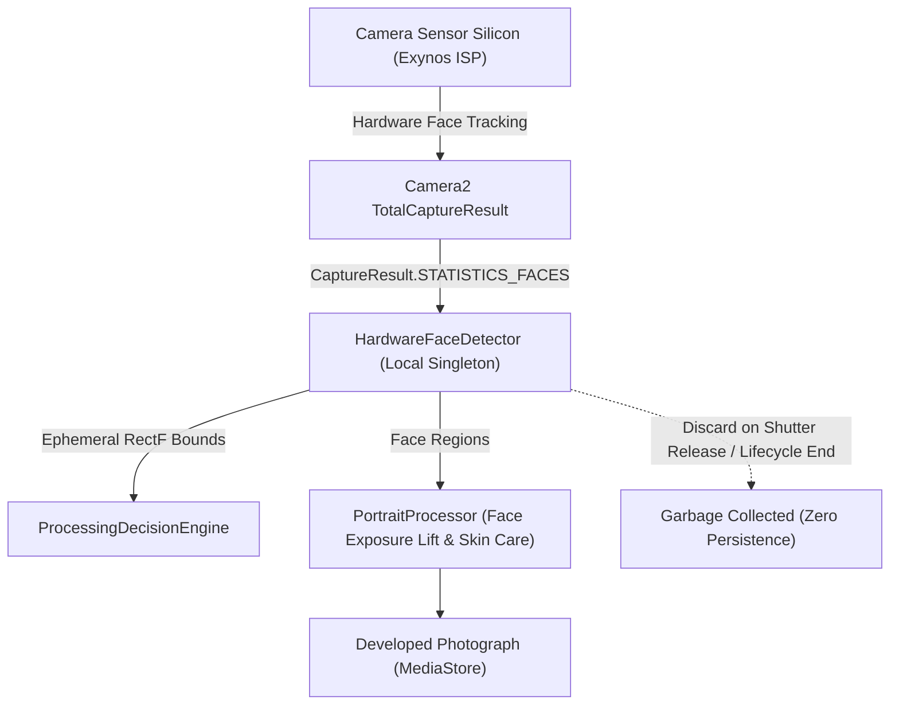

# CAMELEO Privacy Architecture
## On-Device Scene Intelligence, Face Awareness & Biometric Protection

**Project:** CAMELEO  
**Package:** `com.craftcam.app.portrait` & `com.craftcam.app.scene`  
**Classification:** Privacy Specification & Compliance Architecture  
**Strict Mandate:** 100% Local Processing, Zero Biometric Persistence, Zero Cloud Egress  

---

## 1. Core Privacy Directives

CAMELEO is designed with privacy-by-design principles for computational and portrait photography:
1. **Zero Cloud Ingestion:** No photograph, image buffer, preview frame, crop, or metadata is ever uploaded to any external server, cloud API, telemetry sink, or machine-learning service.
2. **Zero Biometric Identity Recognition:** Face detection identifies only the spatial bounding box ($[x_0, y_0, x_1, y_1]$) and head orientation of human faces to calibrate photographic exposure and protect skin texture. No facial embeddings, biometric hashes, vector templates, or identity markers are ever computed, stored, or compared.
3. **Hardware ISP Execution:** Face detection relies on the on-device Camera2 sensor Image Signal Processor (`CaptureRequest.STATISTICS_FACE_DETECT_MODE`), executing directly on the physical camera silicon without transmitting image pixels to third-party SDKs.
4. **Transient Memory Lifecycle:** All detected face bounding boxes (`FaceRegion`) and soft skin masks are allocated in volatile heap buffers that are discarded immediately upon image development and never written to disk or MediaStore EXIF metadata.
5. **No Beautification or Biometric Manipulation:** Skin whitening, facial slimming, eye enlargement, nose reshaping, and artificial plastic blurring are strictly prohibited. The system preserves the subject's authentic human appearance.

---

## 2. Face Detection Data Flow

---

## 3. Data Classification & Lifecycle

| Data Type | Generation Source | Persistence | Network Transmission | Privacy Classification |
| :--- | :--- | :---: | :---: | :--- |
| **Preview Video Buffer** | CameraX Preview | Ephemeral ($< 16\,\text{ms}$) | None | `DEVICE-LOCAL VOLATILE` |
| **Hardware Face Bounds** | Camera2 HAL (`STATISTICS_FACES`) | Ephemeral (Current Frame) | None | `DEVICE-LOCAL VOLATILE` |
| **Soft Skin Mask** | `SkinRegionAnalyzer` | Ephemeral (Capture Session) | None | `DEVICE-LOCAL VOLATILE` |
| **Scene Classification** | `SceneClassifier` | UI Display Only | None | `DEVICE-LOCAL TELEMETRY` |
| **Output Photograph** | `ImageProcessor` | User's Device MediaStore | None | `USER STORAGE (DCIM/Cameleo)` |
| **Biometric Face Embeddings** | Not Implemented | NEVER GENERATED | None | `STRICTLY PROHIBITED` |

---

## 4. Compliance Verification

- **GDPR / CCPA / BIPA Alignment:** Because CAMELEO does not collect, process, or store biometric identifiers or information that can identify an individual, the application complies with strict biometric privacy regulations (including the Illinois Biometric Information Privacy Act).
- **Network Permissions:** The application manifest contains zero network permissions (`android.permission.INTERNET` is neither requested nor used for image processing). Network transmission of photographic data is impossible by design.

