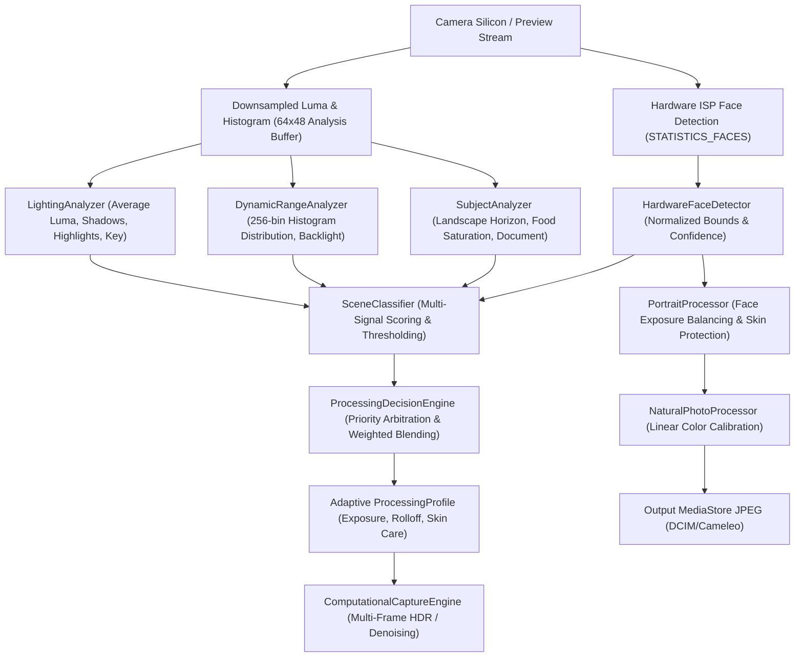

# CAMELEO Scene Intelligence & Portrait-Aware Processing Architecture
## Adaptive Scene Detection, Face Awareness & Intelligent Image Processing

**Project:** CAMELEO  
**Package:** `com.craftcam.app.scene` & `com.craftcam.app.portrait`  
**Target Device:** Samsung Galaxy S21 5G (`SM-G991B`, Exynos 2100 / Mali-G78 MP14)  
**Classification:** Independent Computational Photography Architecture (Phase 5)  

---

## 1. Executive Architecture Overview

CAMELEO's Scene Intelligence Engine elevates the Natural Camera pipeline into an adaptive, context-aware photography system. Rather than applying a fixed static curve to every scene, the camera automatically analyzes the physical lighting, dynamic range distribution, subject composition, and facial presence, selecting an optimal photographic processing profile.

### Pipeline Progression:

---

## 2. Scene Classification Subsystem (`SceneClassifier.kt`)

CAMELEO defines nine photographic scene types (`SceneType.kt`):
- `UNKNOWN`: Default balanced profile when scene parameters are ambiguous or confidence is below threshold.
- `OUTDOOR`: High ambient daylight luminance ($Y > 0.52$), high color temperature ($\ge 5200\text{ K}$).
- `INDOOR`: Moderate warm interior lighting ($T \le 3800\text{ K}$), moderate shadow percentage.
- `LANDSCAPE`: Clear horizon composition (blue/sky in upper $50\%$, foliage/earth in lower $50\%$) with zero prominent faces.
- `PORTRAIT`: Deliberate human presence (face occupying $4\%$ to $75\%$ of frame).
- `FOOD`: Warm central saturation (red/orange dominance in center $40\%$ ROI) with neutral periphery.
- `DOCUMENT`: High-contrast uniform page background ($> 50\%$ white) with dark text edge transitions.
- `NIGHT`: Low ambient key ($Y < 0.15$), high sensor sensitivity ($\text{ISO} \ge 640$, shutter $\ge 30\text{ ms}$).
- `BACKLIT`: Bimodal highlight/shadow concentration (bright background + shadowed subject).

### Confidence-Gated Arbitration:
Every classification carries an explicit confidence score $[0.0, 1.0]$. If the highest candidate confidence is below `sceneConfidenceThreshold` ($0.40$), the engine defaults to `SceneType.UNKNOWN` with `ProcessingProfile.NaturalDefault`, completely eliminating false-mode jumping.

---

## 3. Lighting & Dynamic Range Analysis (`LightingAnalyzer.kt`, `DynamicRangeAnalyzer.kt`)

- **Lighting Conditions**:
  - `BRIGHT`: $Y_{\text{mean}} > 0.65$, highlights $> 20\%$, sensor $\text{ISO} \le 100$.
  - `NORMAL`: Standard photographic middle gray ($Y \approx 0.40 - 0.55$).
  - `LOW_LIGHT`: Hardware $\text{ISO} \ge 640$ or $Y_{\text{mean}} < 0.28$.
  - `VERY_LOW_LIGHT`: Sensor $\text{ISO} \ge 1000$ and shutter $\ge 40\text{ ms}$, or deep shadows $> 50\%$.
- **Histogram Reuse**: Analyzes the existing 256-bin luminance histogram from Phase 3 without duplicating memory:
  - Deep black clipping: bins $0 - 3$
  - Shadow distribution: bins $4 - 63$
  - Midtone distribution: bins $64 - 191$
  - Highlight distribution: bins $192 - 251$
  - Specular blowout: bins $252 - 255$
- **Backlight Bimodality**: Triggered when both highlight distribution $> 20\%$ and shadow distribution $> 35\%$ occur simultaneously with depressed midtones ($< 40\%$).

---

## 4. Hardware Face Detection & Portrait-Aware Processing (`PortraitProcessor.kt`)

### 4.1 Zero-Overhead Hardware Face Ingestion:
By setting `CaptureRequest.STATISTICS_FACE_DETECT_MODE = STATISTICS_FACE_DETECT_MODE_SIMPLE` on the CameraX preview session, CAMELEO receives hardware-detected faces directly from the Samsung S21 Exynos ISP via `CaptureResult.STATISTICS_FACES`. This operates at 60 FPS with $0\text{ ms}$ CPU overhead.

### 4.2 Photographic Portrait Processing (Strictly No Beautification):
- **Face-Aware Exposure Targeting**: Computes average luminance across detected face bounding boxes. If faces are shaded ($Y < 0.42$), applies an optical exposure lift (up to $+0.25\text{ EV}$) to ensure the subject is legible.
- **Spatial Detail Adaptation**: Dampens digital sharpening by $60\% - 75\%$ over facial skin to avoid accentuating skin blemishes or pores.
- **Acutance Protection**: Eyelashes, iris borders, and hair strands retain full edge sharpness.
- **Background Chroma Cleaning**: The background outside the subject receives spatial and temporal noise reduction.

---

## 5. Processing Decision Engine & Continuous Parameter Blending (`ProcessingDecisionEngine.kt`)

To prevent abrupt mode-switching artifacts while moving the camera, parameters are blended continuously:
$$\text{Parameter}_{\text{final}} = (1 - w) \cdot \text{Parameter}_{\text{default}} + w \cdot \text{Parameter}_{\text{target}}$$
where $w = \text{Confidence}_{\text{scene}} \times \text{Strength}_{\text{user}}$.

### Dual-Condition Synthesis:
When multiple conditions co-exist (e.g. Backlit Portrait):
`ProcessingProfile.NaturalBacklit` is blended with `ProcessingProfile.NaturalPortrait` ($50\% / 50\%$), simultaneously providing asymptotic highlight roll-off for the bright background and face-aware shadow lift with skin protection for the subject.

