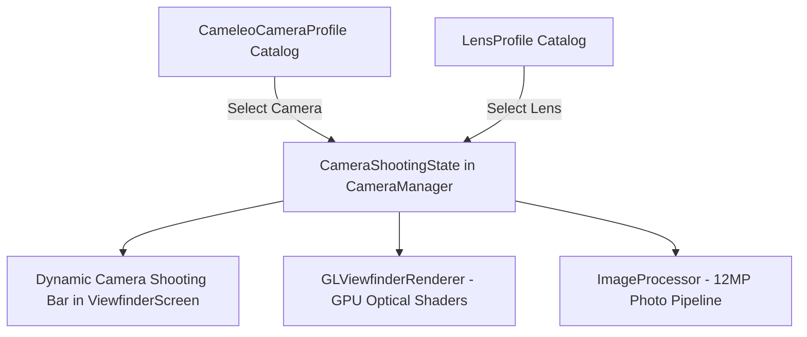

# CAMELEO — Camera System Architecture Audit
## Comprehensive Inspection of Capture, Rendering, and Camera Selection Pipeline

---

## 1. Executive Summary

This audit assesses the complete camera architecture of **CAMELEO** in preparation for the **Camera-Specific Shooting Screen & Lens System**. The goal is to evolve CAMELEO from a generic filter-wheel camera into a data-driven vintage camera simulation where each camera body has its own distinctive optical personality, focal length options, supported lenses, exposure traits, aspect ratios, and shooting controls.

The existing camera-gallery / collection screen (`CollectionScreen.kt`) and darkroom gallery must remain visually and functionally unchanged. All enhancements are isolated to the shooting screen (`ViewfinderScreen.kt`), the Camera2/CameraX state machine (`CameraManager.kt`, `CameraState.kt`), the OpenGL ES 3.0 live preview renderer (`GLViewfinderRenderer.kt`, `ShaderConstants.kt`), and the 12MP full-sensor capture engine (`ImageProcessor.kt`).

---

## 2. Current Architecture Inspection

### 2.1 Camera Selection Flow
- **Navigation Host**: [`CraftCamNavHost.kt`](file:///c:/Users/User/Downloads/DazzProject/app/src/main/java/com/craftcam/app/ui/navigation/CraftCamNavHost.kt)
  - Holds `var selectedPreset by remember { mutableStateOf(...) }`.
  - Defines routes: `viewfinder`, `collection`, `gallery`, `settings`.
  - Start destination is `viewfinder`.
- **Collection / Gallery Page**: [`CollectionScreen.kt`](file:///c:/Users/User/Downloads/DazzProject/app/src/main/java/com/craftcam/app/ui/collection/CollectionScreen.kt)
  - Displays cameras categorized by `CameraCategory` (Analog Film, CCD Digital, Disposable, Instant, Camcorder).
  - Presents 3D camera body cards (e.g. D Classic, Warm Film, D Exp, Polaroid, Soft Film, D FunS, Classic U, CCD).
  - Tapping a camera invokes `onSelectPreset(preset)` and pops back to the viewfinder.
- **Shooting Screen Preset Wheel**: [`CameraWheelSelector.kt`](file:///c:/Users/User/Downloads/DazzProject/app/src/main/java/com/craftcam/app/ui/components/CameraWheelSelector.kt)
  - Horizontal carousel above shutter button allowing rapid camera switching directly on the viewfinder.
  - Tapping the collection grid icon opens `CollectionScreen`.

### 2.2 Selected-Camera Data Model
- **Current Model**: [`CameraPreset.kt`](file:///c:/Users/User/Downloads/DazzProject/app/src/main/java/com/craftcam/app/model/CameraPreset.kt)
  - `id: String`, `name: String`, `subtitle: String`, `category: CameraCategory`, `year: String`
  - `colorGrading: ColorGradingConfig` (contrast, saturation, temperature, tint, gamma, fade, highlightRollOff, shadowTint)
  - `grain: GrainConfig`, `lens: LensConfig`, `lightLeak: LightLeakConfig?`, `halation: HalationConfig?`, `dust: DustConfig?`, `flashOverlay: FlashOverlayConfig?`, `dateStamp: DateStampConfig?`, `border: BorderConfig?`
- **Limitation**: Currently, `CameraPreset` bundles film color grading, lens optical parameters, and camera metadata together into a single flat struct without modeling **removable lenses** (Fisheye, Prism, Starburst, ND), **camera-specific focal length sets**, or **camera-specific UI capabilities**.

### 2.3 Shooting Screen Architecture
- **Root Screen**: [`ViewfinderScreen.kt`](file:///c:/Users/User/Downloads/DazzProject/app/src/main/java/com/craftcam/app/ui/viewfinder/ViewfinderScreen.kt)
  - Layout hierarchy:
    1. `GLSurfaceView` with `GLViewfinderRenderer` for zero-copy real-time OpenGL ES 3.0 preview.
    2. `ViewfinderOverlay` for tap-to-focus reticle and vertical sun brightness drag.
    3. `CaptureFrameOverlay` for movable, resizable composition window with focal length readout.
    4. `TopControlBar` (Flash, Aspect Ratio, Timer, Grid, Brightness, Analog Lab Sheet, Settings).
    5. `BottomControls` (Mode selector: NATURAL / FILM / PRO, Preset Carousel, Gallery Thumbnail, Shutter Button, Front/Rear Camera Switch).
  - Lifecycle: `initializeWithGLSurface` binds `SurfaceTexture` to CameraX `Preview` use-case.

### 2.4 Zoom & Focal Length Implementation
- **Hardware Zoom**: Managed via CameraX `cameraControl.setZoomRatio(clamped)` in [`CameraManager.kt`](file:///c:/Users/User/Downloads/DazzProject/app/src/main/java/com/craftcam/app/camera/CameraManager.kt).
- **Physical Multi-Camera Zoom Discovery**: [`CameraDiscovery.kt`](file:///c:/Users/User/Downloads/DazzProject/app/src/main/java/com/craftcam/app/camera/CameraDiscovery.kt) queries `CameraCharacteristics` on Samsung Galaxy S21 to discover Ultra-Wide (13mm, 0.6×), Wide (26mm, 1.0×), and Telephoto (70mm, 3.0×).
- **Simulated Focal Length**: Displayed by `CaptureFrameState.effectiveFocalLengthMm = baseFocalLengthMm / sizeFraction`.

### 2.5 Capture-Frame Composition Window Implementation
- **Files**: [`CaptureFrameState.kt`](file:///c:/Users/User/Downloads/DazzProject/app/src/main/java/com/craftcam/app/captureframe/CaptureFrameState.kt), [`CaptureFrameOverlay.kt`](file:///c:/Users/User/Downloads/DazzProject/app/src/main/java/com/craftcam/app/captureframe/CaptureFrameOverlay.kt), [`CaptureFrameMapper.kt`](file:///c:/Users/User/Downloads/DazzProject/app/src/main/java/com/craftcam/app/captureframe/CaptureFrameMapper.kt).
- **Behavior**: A movable, resizable composition rectangle over the full camera preview. Area outside is dimmed by 28% scrim. Inside area has a thin white rounded border with focal length readout above the top edge.
- **Decoupling**: Independent from camera optical zoom. Snapshot is frozen at shutter tap and applied in `ImageProcessor`.

### 2.6 Filter & Optical Rendering Pipeline
- **Live Viewfinder (OpenGL ES 3.0)**:
  - Fragment Shader: [`ShaderConstants.kt`](file:///c:/Users/User/Downloads/DazzProject/app/src/main/java/com/craftcam/app/gl/shaders/ShaderConstants.kt)
  - Pipeline order:
    `sTexture (OES)` $\to$ Barrel Distortion $\to$ Chromatic Aberration $\to$ Softness Flare $\to$ 3D Hald CLUT $\to$ Tone/Color Grading $\to$ Halation $\to$ Light Leak $\to$ Film Grain $\to$ Scanlines.
- **Still Photo Capture (12MP full-sensor)**:
  - Processed in [`ImageProcessor.kt`](file:///c:/Users/User/Downloads/DazzProject/app/src/main/java/com/craftcam/app/processor/ImageProcessor.kt).
  - Single-pass matrix orientation and composition crop $\to$ CPU/RenderScript/GL effects $\to$ Date stamp $\to$ Border $\to$ MediaStore.

---

## 3. Gap Analysis for Camera-Specific System

| Requirement | Current State | Required Enhancement |
|---|---|---|
| **Camera vs Lens Separation** | Bundled in `CameraPreset` | Deconstruct into `CameleoCameraProfile` (camera body) and `LensProfile` (optical accessory). |
| **Camera-Specific Focal Lengths** | Continuous zoom fraction | Discrete camera-specific focal length selector (e.g. 37mm/50mm for D Classic; 13mm/26mm for Fisheye). |
| **Fisheye Lens Distortion** | Simple weak barrel quadratic | True GPU radial fisheye transformation (Fisheye F aggressive vs Fisheye W wide). |
| **Prism Lens** | None | Multi-copy refracted optical dispersion shader pass with highlight blooming. |
| **Starburst Lens** | None | Specular highlight thresholding with multi-directional star rays. |
| **ND Filter** | None | Exposure bias attenuation + optical transmission darkening. |
| **Color Flash** | None | Dedicated flash tinting profile activated only when flash fires. |
| **Camera-Specific Shooting UI** | Static controls across all cameras | Dynamic shooting bar: exposes only lenses and focal lengths supported by selected camera. |

---

## 4. Integration Blueprint

### 4.1 Existing Files Reused Without Breaking Changes
- `CollectionScreen.kt`: Unmodified, preserves all 3D camera shelves and navigation.
- `CraftCamNavHost.kt`: Retains routing and selected camera state.
- `CaptureFrameState.kt` & `CaptureFrameMapper.kt`: Reused for composition cropping.
- `BorderRenderer.kt` & `DateStampRenderer.kt`: Reused for final photographic frames.

### 4.2 Files to Enhance
- `ShaderConstants.kt`: Add GPU uniforms and algorithms for Fisheye F/W, Prism refraction, Starburst, and ND filter.
- `GLViewfinderRenderer.kt`: Bind lens accessory uniforms and optical state dynamically.
- `ImageProcessor.kt`: Add high-resolution optical processing corresponding to selected `LensProfile`.
- `CameraState.kt`: Introduce `CameraShootingState`, `CameleoCameraProfile`, `LensType`, `LensProfile`.
- `ViewfinderScreen.kt`: Integrate dynamic camera shooting bar (focal length tabs and lens accessory pill).

---

## 5. Potential Regressions & Mitigation Strategy

1. **CameraX Session Re-binding**: Changing lenses must NOT restart CameraX or unbind use cases. Lens switching will update shader uniforms and camera exposure parameters in under 5ms.
2. **Recomposition Churn**: Lens and focal length states must use `rememberUpdatedState` and immutable dataclasses to prevent viewfinder recomposition drops.
3. **GPU Shader Thermal Throttle**: Fisheye, Prism, and Starburst algorithms must use single-pass or low-tap loops (under 8 texture samples) to maintain 60 FPS on Samsung S21 GPU (Mali-G78).
4. **Natural / Pro Mode Isolation**: All lens accessories must be bypassed in Natural and Pro camera modes.

