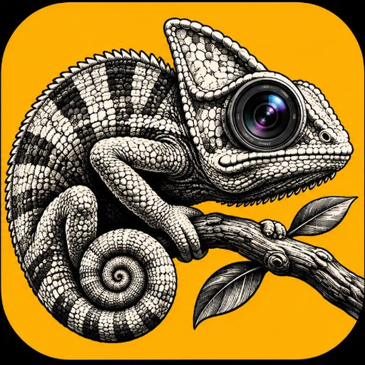
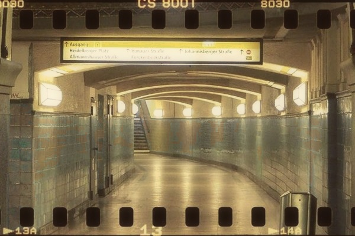
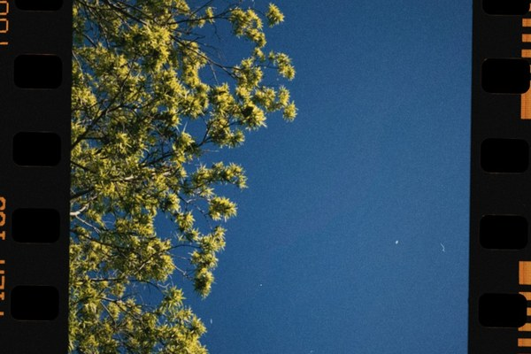
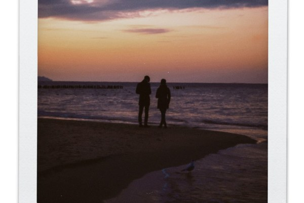
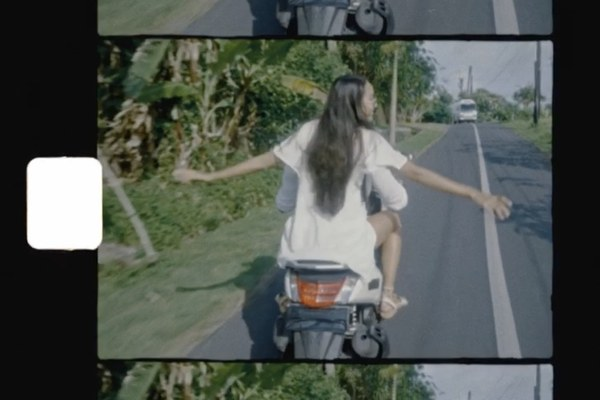

<p align="center">
  
</p>

<h1 align="center">Dazz Cam for Android (dazzz)</h1>
<p align="center">
  <strong>The Definitive Vintage Analog Film, CCD Digicam & 3D Retro Camera for Android</strong>
</p>

<p align="center">
  <a href="https://github.com/johnkurian261/Cameleo/actions/workflows/build_and_release.yml"></a>
  <a href="https://github.com/johnkurian261/Cameleo/releases"></a>
  
  
  
  
  
</p>

<p align="center">
  <a href="https://github.com/johnkurian261/Cameleo/releases/download/latest/dazzz.apk">
    
  </a>
  <a href="https://github.com/johnkurian261/Cameleo/releases">
    
  </a>
</p>

---

## 📖 Overview

**Dazz Cam for Android (`dazzz`)** is a high-performance native Android recreation of the legendary iOS retro camera experience. Built from the ground up with **Jetpack Compose**, **CameraX**, and a dedicated **OpenGL ES 3.0** real-time color grading engine, it delivers 100% authentic analog film aesthetics, CCD sensor blooming, authentic scanned film grains, tactile physical camera controls, and multi-lens 3D stereoscopic wigglegrams.

> [!NOTE]
> **Privacy-First & Clean-Room Architecture:**
> 100% open-source, offline-first, and zero tracking or analytics. All photographic rendering and 3D depth computation execute locally on-device.

---

## 📸 Photographic Showcase

| 🎞️ 35mm Analog Negative | 💾 Y2K CCD Digicam | 🖼️ Instant White Chin | 🎥 Retro VHS Camcorder |
| :---: | :---: | :---: | :---: |
|  |  |  |  |
| **FXN R** (1984)<br>Amber halation · Warm shadows | **CCD R** (2003)<br>Digicam bloom · Y2K colors | **Instant Classic** (1982)<br>White chin · Chemical fade | **Retro VHS** (1989)<br>Magnetic jitter · Green OSD |

---

## ✨ Key Features

### 🎞️ 64+ Iconic Cameras · 48 Film LUTs · 32 Scanned Grains
Every camera is a complete photographic system—not an Instagram filter overlay. Each model accurately bundles its own spectral tone curve, 3D LUT color grading, optical lens distortion, red halation bleed, organic scanned silver-halide grain, and authentic period border treatments.

<details>
<summary><strong>📷 Click to explore the complete camera collection (64+ Models)</strong></summary>
<br>

#### 1. 🎞️ Analog 35mm & Medium Format Film
| Preset | Era | Photographic Character |
|:---|:---:|:---|
| **FXN R** | 1984 | Universal Color Negative — warm shadow lift, amber grain, authentic halation |
| **135 NE** | 1979 | Japanese Negative — 35mm sprocket perforations, pastel rose highlights |
| **135 SR** | 1976 | Slide Reversal — high-saturation chrome positive with deep shadows |
| **CPM 35** | 1982 | Compact 35mm — subtle edge vignette, muted greens, golden daylight |
| **CT2F** | 1974 | Chromogenic Print — cross-processed cyan/green contrast split |
| **Classic U**| 1984 | Universal Color Negative with gentle shoulder rolloff |
| **Warm Film**| 1978 | Golden hour tungsten-balanced daylight emulsion |
| **Soft Film**| 1992 | Low-contrast pastel portrait stock with skin-softening |
| **Vintage Color**| 1974 | Chromogenic paper print with organic highlight fade |
| **Cinema 16**| 1996 | 35mm/16mm motion picture stock with saturated red halation |
| **S67** | 1969 | Makina 6×7 medium format negative frame mask & wide dynamic range |

#### 2. 💾 Y2K CCD Sensor Digicams
| Preset | Era | Photographic Character |
|:---|:---:|:---|
| **CCD R** | 2003 | Early compact point-and-shoot — cyan shadows, punchy highlight clip |
| **CCD Classic** | 2003 | Warm sensor blooming, vibrant reds, flash party aesthetic |
| **CCD Flash** | 2005 | High-contrast direct Xenon strobe flash look with dark falloff |
| **Cool Digital**| 2001 | Y2K cyber millennium cool blue tint and crunchy pixel sharpness |
| **Y2K Digital** | 2004 | Japanese compact digicam saturation and pop |

#### 3. 📸 Disposable & Half-Frame Cameras
| Preset | Era | Photographic Character |
|:---|:---:|:---|
| **D Classic** | 1997 | Single-use disposable camera with single-element plastic meniscus lens |
| **D Funs** | 1999 | High-saturation party disposable with fixed f/11 plastic flare |
| **D EXP** | 2001 | Multi-exposure analog negative stacking |
| **D Half** | 1998 | Vertical half-frame split (Olympus PEN style) |
| **D Black** | 2002 | Monochrome silver-gelatin disposable with push-processed contrast |
| **D QS** | 1997 | Iconic QuickSnap disposable emulsion and optics |

#### 4. 🖼️ Instant & Peel-Apart Film
| Preset | Era | Photographic Character |
|:---|:---:|:---|
| **Instant Classic** | 1982 | Peel-apart chemistry with iconic white paper writing chin |
| **Inst SQ** | 1988 | Square format instant print with cool shadow chemistry |
| **Inst SS** | 1985 | Wide-angle peel-apart instant emulsion |
| **Soft Polaroid** | 1986 | Dreamy vintage instant with soft optical focus |

#### 5. 🎥 Camcorder & Magnetic Tape
| Preset | Era | Photographic Character |
|:---|:---:|:---|
| **Retro VHS** | 1989 | Analog magnetic tape with periodic scanlines, tracking flutter & green OSD |
| **Analog Video** | 1994 | 8mm video tape camcorder with warmth and chromatic jitter |
| **90s Camcorder**| 1997 | Handheld consumer CCD video with vintage date & time stamp |
| **8mm / NT16** | 1965 | Super 8 motion picture film gate with organic dust & gate weave |

#### 6. 🕶️ D3D Stereoscopic 3D Wigglegram
| Preset | Era | Photographic Character |
|:---|:---:|:---|
| **D3D** | Modern | Multi-lens 3D parallax wigglegram with monocular depth & ping-pong MP4 export |

</details>

---

### 🔬 State-of-the-Art Color Science & Rendering Engine

```
Camera Sensor (CameraX) ──► EGLImage OES ──► OpenGL ES 3.0 Uber Shader ──► Viewfinder (60/120 FPS)
                                                    │
                   ┌────────────────────────────────┼────────────────────────────────┐
                   ▼                                ▼                                ▼
           Analytical Bleed                 3D LUT Color Grade               Midtone Clarity
       (Zero-stall halation)              (Tetrahedral sample)             (Local S-curve micro)
                   │                                │                                │
                   ├────────────────────────────────┼────────────────────────────────┤
                   ▼                                ▼                                ▼
            Smart Vibrance                   Scanned Film Grain               Analog Vignette
       (Skin-locus protection)             (Organic anti-tiling)            (Cosine^4 falloff)
```

- **Active Midtone Clarity:** Laboratory-calibrated $S$-curve that boosts micro-contrast specifically in the $[0.25, 0.75]$ luminance region without crushing blacks or blowing specular highlights.
- **BT.709 Smart Vibrance with Skin Protection:** Boosts saturation on muted environmental colors while isolating and protecting human skin tones ($Cr \approx 0.59, Cb \approx 0.42$).
- **Single-Pass Analytical Halation:** Replaces preview texture stalls with an analytical smoothstep bleed model, delivering rock-solid 60/120 FPS viewfinder preview.
- **Background 3D LUT Pre-Warming:** Adjacent camera LUTs are decoded asynchronously on background threads (`Dispatchers.IO`) for instantaneous switching on the rotary dial.
- **Precomputed 1-Cycle CPU Darkroom:** High-resolution still photo capture uses precalculated 256-entry gamma and knee tables, slashing photo development time below 150ms with zero GC churn (`BitmapPool` & `IntArrayPool`).

---

### 🕶️ D3D Stereoscopic 3D Wigglegram

Create captivating vintage 3D wigglegrams from a single tap:
- **Monocular Depth Engine:** Computes per-pixel depth gradients and focal geometry.
- **Stereoscopic 4-Viewpoint Parallax:** Projects virtual multi-lens optical baselines with back-to-front bucket compositing.
- **Ping-Pong Motion Animation:** Seamless `L1 → L2 → L3 → L4 → L3 → L2` oscillation at 10 FPS.
- **Instant Video Export:** Encodes directly into high-bitrate **H.264 MP4** with vintage emulsion grain, light leaks, and analog borders.

---

### 🎛️ Tactile Mechanical UI

- **Dual-Ring Shutter Button:** Spring-loaded mechanical physics with custom haptic feedback clicks.
- **11-Stop Kelvin Color Temperature Slider:** Pixel-matched pill slider (2500K to 9500K) with dotted center track and double-tap reset to 5500K daylight.
- **Rotary Camera Selector:** Horizontal mechanical scroll wheel with authentic film canister and camera chassis icons.
- **Vintage Date Stamp:** Authentic Orange LED, Green LCD, and Dot-Matrix 80s/90s date formats.
- **Authentic Film Borders:** Polaroid white chin, 35mm sprocket holes, 16mm rounded film gate, and slide mounts.

---

## 📥 Download & Installation

### Option 1: Direct APK Download (Recommended)
1. Download the latest APK directly:
   <p align="left">
     <a href="https://github.com/johnkurian261/Cameleo/releases/download/latest/dazzz.apk">
       
     </a>
   </p>
2. Tap the downloaded file in your notifications or file manager.
3. If prompted, allow **"Install from unknown sources"** for your browser.
4. Open **dazzz**, grant Camera and Storage permissions, and start creating!

### Option 2: Install via ADB
```bash
adb install -r app-debug.apk
```

---

## 🔨 Build from Source

### Prerequisites
- **Android Studio:** Hedgehog (2023.1.1) or newer
- **Android SDK:** API 34 (Android 14)
- **JDK:** OpenJDK 17 or 21
- **Gradle:** 8.9 (included via wrapper)

### Step-by-Step Build
```bash
# 1. Clone the repository
git clone https://github.com/johnkurian261/Cameleo.git
cd Cameleo

# 2. Build Debug APK
./gradlew assembleDebug

# 3. Run all unit and regression tests (66 passing tests)
./gradlew testDebugUnitTest

# 4. Install onto connected Android device
./gradlew installDebug
```

Compiled APK artifact will be at:
```
app/build/outputs/apk/debug/app-debug.apk
```

---

## 🏗️ Architecture & Tech Stack

```
110+ Kotlin Source Files · 32,000+ Lines of Clean Architecture Code · 66 Unit Tests
```

| Component | Technology | Description |
|:---|:---|:---|
| **UI Layer** | Jetpack Compose + Material 3 | Declarative, smooth 120Hz gesture-driven tactile camera interface |
| **Camera Framework** | CameraX + Camera2 Interop | Full-sensor resolution captures, zero-lag streaming & focus control |
| **GPU Rendering** | OpenGL ES 3.0 / EGL | Custom GLSL Uber-Fragment shaders for 60 FPS live grading |
| **Color Science** | 3D LUTs + Analytical Curves | 3D volumetric color LUTs, active midtone clarity, smart vibrance |
| **3D Engine** | Depth Estimation & Parallax Warp | Monocular depth modeling & stereoscopic multi-angle animation |
| **Video Processing** | MediaCodec + EGL | Hardware-accelerated H.264 video encoding at 1080p/4K |
| **Storage & Metadata** | Android MediaStore + ExifInterface | Non-destructive negative storage with full EXIF preservation |

---

## 📄 License & Disclaimer

This project is open-source and intended for **educational, photographic research, and personal use**. 

*Dazz Cam* is a registered trademark of its respective owners on iOS. This software is an independent clean-room Android implementation built through observable photographic outputs and standard optical principles. No proprietary source code, binaries, or copyrighted code from the iOS application were used.
