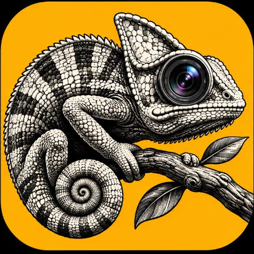

<p align="center">
  
</p>

<h1 align="center">dazzz</h1>
<p align="center"><strong>Vintage Analog Camera for Android</strong></p>

<p align="center">
  <a href="https://github.com/johnkurian261/Cameleo/actions/workflows/build_and_release.yml"></a>
  <a href="https://github.com/johnkurian261/Cameleo/releases/latest"></a>
  
  
  
</p>

<p align="center">
  <a href="https://github.com/johnkurian261/Cameleo/releases/latest/download/dazzz.apk">
    
  </a>
</p>

---

> **dazzz** is a premium vintage camera app for Android inspired by [Dazz Cam](https://apps.apple.com/app/dazz-analog-filter-camera/id1459773543) (iOS). It faithfully recreates Dazz Cam's signature film presets, camera model collection, real-time GPU color grading, and tactile UI — natively on Android using Jetpack Compose, CameraX, and OpenGL ES 3.0.

> [!NOTE]
> This is a clean-room Android implementation built through analysis of observable UI behavior, asset structure, and photographic output. No proprietary source code was copied. For educational and personal use only.

---

## 📥 Install

| | |
|---|---|
| **Direct APK** | [**dazzz.apk**](https://github.com/johnkurian261/Cameleo/releases/latest/download/dazzz.apk) (~35 MB) |
| **All Releases** | [GitHub Releases](https://github.com/johnkurian261/Cameleo/releases) |

**Steps:** Download APK → Enable "Install Unknown Apps" when prompted → Install → Grant Camera & Storage permissions → Shoot.

---

## ✨ Features

### 🎞️ 64 Camera Presets · 48 Film LUTs · 32 Grain Textures

Every preset is a complete photographic system — not just a filter. Each one bundles its own color LUT, grain density, light leak overlays, lens distortion curve, border treatment, and date stamp style.

<details>
<summary><strong>📷 Full Camera Collection (click to expand)</strong></summary>

#### Analog Film
| Preset | Era | Character |
|---|---|---|
| FXN R | 1984 | Universal Negative — warm shadow lift, amber grain |
| 135 NE | 1979 | Japanese Negative — 35mm sprocket borders, rose highlights |
| 135 SR | 1976 | Slide Reversal — saturated chrome transparency |
| CPM 35 | 1982 | Compact 35mm — soft corner vignette, muted tones |
| CT2F | 1974 | Chromogenic Print — cross-processed greens |
| Classic | 1984 | Universal Color Negative |
| Warm Film | 1978 | Golden Hour Emulsion |
| Soft Film | 1992 | Pastel Portrait Stock |
| Vintage Color | 1974 | Chromogenic Fade |
| Faded Film | 1968 | Aged Paper Negative |
| Cinema Film | 1996 | 35mm Motion Picture with Red Halation |

#### CCD Digital
| Preset | Era | Character |
|---|---|---|
| CCD R | 2003 | Early Compact Digicam — blue cast, JPEG compression |
| CCD Classic | 2003 | Warm CCD sensor bloom |
| CCD Flash | 2005 | Night Party Strobe |
| Cool Digital | 2001 | Y2K Cyber Millennium |
| Y2K Digital | 2004 | Aesthetic Digicam |
| Retro Compact | 2006 | Point-and-Shoot |

#### Disposable & Toy Cameras
| Preset | Era | Character |
|---|---|---|
| D Classic | 1997 | Single-Use Plastic Lens |
| D Funs | 1999 | Party Disposable |
| D EXP | 2001 | Double Exposure Disposable |
| D Slide | 2000 | Slide Film Disposable |
| D Half | 1998 | Half-Frame Disposable |
| D Black | 2002 | B&W Disposable |
| D QS | 1997 | QuickSnap Style |

#### Instant & Polaroid
| Preset | Era | Character |
|---|---|---|
| Instant Classic | 1982 | Peel-Apart Chemical Film with White Chin |
| Inst C | 1986 | Square Instant Print |
| Inst SQ | 1988 | Square Format Instant |
| Inst SQ C | 1990 | Square Instant Classic |
| Inst SS | 1985 | Wide Instant Print |
| Soft Polaroid | 1986 | Dreamy Instant |
| Vintage Instant | 1979 | Aged Emulsion 600 |

#### Specialty & Art
| Preset | Era | Character |
|---|---|---|
| D3D | 2024 | Multi-frame Wigglegram with depth parallax |
| Zero | 2024 | High-fidelity reference camera |
| IR | 2008 | Infrared False Color |
| Mono | — | Classic B&W Silver Gelatin |
| Lomo | 1992 | Cross-processed Vignette |
| Half Frame | 1965 | Olympus Pen Half-Frame |
| S67 | 1969 | Medium Format 6×7 |
| Kino | 1994 | Super 8 / 16mm Ciné |
| TLR | 1955 | Twin-Lens Reflex |
| Bessa | 1960 | Rangefinder |
| GR D/F | 2005 | Compact Prosumer |
| Collage | — | Multi-shot Grid Collage |

#### Camcorder & Video
| Preset | Era | Character |
|---|---|---|
| Retro VHS | 1989 | Magnetic Tape with Green OSD + Scanlines |
| Analog Video | 1994 | 8mm Home Tape |
| 90s Camcorder | 1997 | Handheld CCD Video |
| VLog | 2020 | Modern Vlog Cam |
| 8mm | 1965 | Super 8 Film |
| NT16 | 1972 | 16mm Newsreel |

</details>

### 🎬 Real-Time GPU Pipeline (OpenGL ES 3.0)

Every frame passes through a single-pass uber-fragment shader at 60 FPS:

```
Camera Sensor → EGLImage → Uber Fragment Shader → Viewfinder
                                    ↓
                     ┌──────────────┼──────────────┐
                     │              │              │
              White Balance    Tonal Curves    Chromatic
              (Temp + Tint)   (Contrast,      Aberration
                               Saturation,    + Barrel
                               Gamma, Fade)   Distortion
                     │              │              │
                     └──────────────┼──────────────┘
                                    ↓
                     ┌──────────────┼──────────────┐
                     │              │              │
                 Film LUT      Light Leaks     Halation
                 (3D Color     (Screen Blend   (Red Dye
                  Grading)      Overlay)        Bloom)
                     │              │              │
                     └──────────────┼──────────────┘
                                    ↓
                     ┌──────────────┼──────────────┐
                     │              │              │
                  Vignette      Film Grain      Scanlines
                  (Optical      (Luminance-     (VHS Periodic
                   Falloff)      Weighted)       Modulation)
                     │              │              │
                     └──────────────┴──────────────┘
                                    ↓
                              Viewfinder / Capture
```

### 🌡️ Authentic Temperature Control

Pixel-matched recreation of the Dazz Cam color temperature slider:

- **Gradient pill track** — 11-stop periwinkle blue → lavender → warm apricot orange
- **Dotted center line** — dark dots across the horizontal midpoint
- **Black thumb with white ring** — solid fill with crisp circular border
- **Continuous 1K adjustment** — fine Kelvin control from 2500K to 9500K with haptic ticks
- **Double-tap to reset** — returns to 5500K daylight

### 📸 D3D Wigglegram Camera

Authentic multi-frame 3D photography with depth-dependent parallax:

- **Monocular depth estimation** with calibrated perspective gradient
- **Pinhole camera model** — virtual baseline and focal length projection
- **4 virtual viewpoints** rendered with back-to-front depth bucket compositing
- **Ping-pong animation** — `L1 → L2 → L3 → L4 → L3 → L2` at 10 FPS
- **H.264 MP4 output** with D3D film LUT, scanned 35mm grain, and retro emulsion
- **Stable live preview** — no UV stretching or real-time warping

### 🖼️ Capture & Darkroom

- Full-sensor resolution capture via CameraX
- Lossless aspect ratio cropping (4:3 · 1:1 · 3:2 · 16:9)
- Multi-stage photographic color grading pipeline
- Vintage date stamps (Orange LED · Green LCD · Dot Matrix)
- Analog borders (Polaroid white chin · 35mm sprockets · 8mm curved gate · Medium format)
- Non-destructive negative caching for re-development
- Export to `DCIM/CRAFTCAM` with EXIF metadata

### 🎛️ Tactile UI

- **Floating 3-dot control menu** — Flash / Composition Frame / Grid
- **Mechanical shutter button** — dual-ring with spring physics and haptic click
- **Camera wheel selector** — horizontal scroll with film-strip camera icons
- **Deep matte canvas** — dark graphite UI (`#0A0B0E`) with vintage amber accents
- **Grouped settings** — Dazz-style preferences with coral toggles (`#E25241`)

---

## 🏗️ Architecture

```
112 Kotlin source files · 32,600+ lines of code · 59 unit tests
```

| Layer | Technology |
|---|---|
| **UI** | Jetpack Compose + Material 3 |
| **Camera** | CameraX + Camera2 interop |
| **Rendering** | OpenGL ES 3.0 (EGLImage pipeline) |
| **Color Science** | 3D LUT interpolation + tonal curves |
| **Depth** | Monocular depth estimation + parallax warp |
| **Video** | MediaCodec H.264 encoder |
| **Storage** | MediaStore + EXIF preservation |
| **Build** | Gradle 8.9 + Kotlin 2.0 + AGP |

---

## 🔨 Build from Source

### Prerequisites

- Android Studio Iguana or later
- Android SDK 34 (`platforms;android-34`)
- JDK 17 or 21
- Gradle 8.9 (via wrapper)

### Build

```bash
# Debug APK
./gradlew assembleDebug

# Release APK
./gradlew assembleRelease

# Run tests
./gradlew test
```

**Output:** `app/build/outputs/apk/debug/app-debug.apk`

### Install via ADB

```bash
adb install -r app/build/outputs/apk/debug/app-debug.apk
```

---

## 📄 License

This project is for **educational and personal use only**. It is a clean-room implementation inspired by Dazz Cam's publicly observable behavior. No proprietary source code, binaries, or copyrighted assets from the original app were used.
