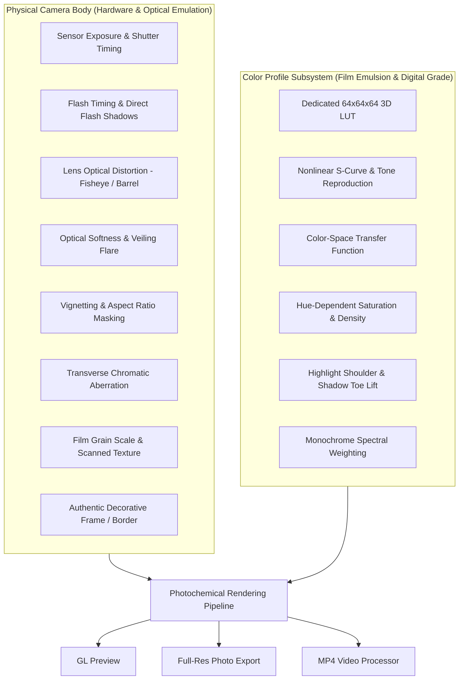

# CAMELEO — Color Profile Architecture Phase 2: Dedicated 3D LUTs and Authentic Colour Science

## 1. Executive Summary

This architecture document details **Phase 2** of the **Color Profile** (Dazz Cam *Color profile* / *色彩配置*) subsystem in CAMELEO.
Following the initial catalog setup (Phase 1), Phase 2 transitions CAMELEO from 5 scalar global adjustments (`tempDelta`, `tintDelta`, `fadeDelta`, `contrastMult`, `satMult`) to **independently calibrated 64×64×64 Hald-8 3D Lookup Tables (512×512 RGBA PNGs)** backed by GPU texture samplers and multi-threaded CPU SIMD pipelines.

---

## 2. Decoupling: Camera Body vs. Color Profile

A core architectural invariant established in Phase 2 is the strict separation between the **Physical Camera Body** and the **Creative Color Profile**:

---

## 3. Dedicated 3D LUT Engine Specification

### 3.1 Dimensions and Storage Format
- **3D Resolution**: $64 \times 64 \times 64$ RGB grid (262,144 unique color transforms).
- **Atlas Layout**: Hald-8 arrangement ($8 \times 8$ grid of $64 \times 64$ 2D slices along blue axis, formatted as a single $512 \times 512$ 32-bit RGBA PNG).
- **GPU Sampling**: GLES 3.0 `sampler3D` (`GL_TEXTURE_3D`) where hardware-accelerated, with fallback to 2D bilinear slice interpolation (`sampleHaldLut` in `ShaderConstants.kt`).
- **CPU Sampling**: Multithreaded fixed-point trilinear interpolation in [`ImageProcessor.kt`](file:///c:/Users/User/Downloads/DazzProject/app/src/main/java/com/craftcam/app/processor/ImageProcessor.kt).

### 3.2 Single-Application Invariant & White Balance Integration
- **Hardware WB Priority**: When Camera2 sets hardware gains (`COLOR_CORRECTION_GAINS`), `isHardwareWbActive` is signaled. The user Kelvin offset is strictly zeroed in software.
- **No Double Grading**: The color profile's 3D LUT replaces the film stock emulsion grade stage rather than stacking on top of an existing camera LUT.
- **Achromatic Monochrome Guarantee**: When Profile `22M` is selected, `isMonochrome = true`. Saturation is forced to $0.0$, shadow tints are zeroed, and Skin Tone Intelligence disables chromatic hue steering so no color tint is reintroduced.

---

## 4. Pipeline Execution Across App Lifecycle

1. **Live Preview ([`GLViewfinderRenderer.kt`](file:///c:/Users/User/Downloads/DazzProject/app/src/main/java/com/craftcam/app/gl/GLViewfinderRenderer.kt))**:
   - `resolveActiveLutAsset(preset, unifiedProfile, tuning)` dynamically resolves the active LUT asset.
   - When the user selects a new color profile in the UI, `updateTuning` swaps textures instantly (using GPU resident caches) or asynchronously in the background.
2. **Video Recording ([`GPUVideoProcessor.kt`](file:///c:/Users/User/Downloads/DazzProject/app/src/main/java/com/craftcam/app/gl/GPUVideoProcessor.kt))**:
   - Queries `CameraProfileCompatibility.isProfileSupported(preset.id)`.
   - Binds the active profile's LUT to Texture Unit 2 with identical tone curve parameters.
3. **Still Image Capture & Gallery Import ([`ImageProcessor.kt`](file:///c:/Users/User/Downloads/DazzProject/app/src/main/java/com/craftcam/app/processor/ImageProcessor.kt))**:
   - Resolves the dedicated profile LUT for film cameras.
   - Applies the 3D LUT through fused parallel CPU SIMD processing.
   - Dispatches `skinEngine.process(..., isMonochrome = isMono)` to ensure zero skin hue deviation in black-and-white.
