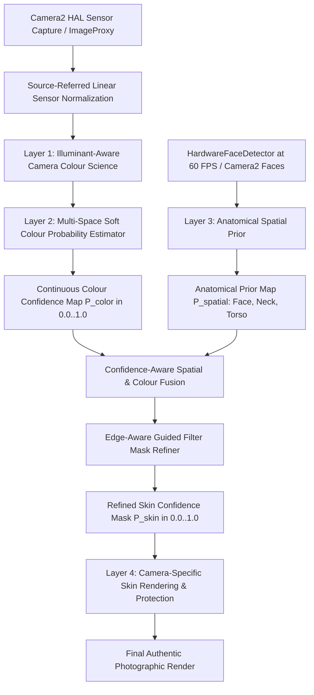

# CAMELEO Skin Tone Intelligence Engine — Architecture Specification

## 1. Overview and Core Philosophy

The Skin Tone Intelligence Engine in CAMELEO (`DazzProject`) provides authentic, physically inspired, camera-specific human skin reproduction across diverse complexions and environmental lighting conditions.

### Strict Aesthetic Guardrails
- **PROHIBITED**:
  - Facial beautification and cosmetic airbrushing.
  - Skin whitening, lightening, or bleaching.
  - Facial reshaping, jaw thinning, or eye enlargement.
  - Skin smoothing, pore removal, or blemish erasure.
  - Artificial relighting or HDR haloing.
  - Forced hue homogenization (forcing all complexions toward a single peach hue).
- **MANDATORY**:
  - Pores, freckles, micro-contrast, and facial textures are preserved without alteration.
  - Broad demographic multi-complexion fidelity across Fitzpatrick Types I through VI.
  - Real environmental lighting (warm tungsten, yellow-green artificial, direct flash falloff) is respected.
  - Camera profiles retain their authentic historical photographic identity.

---

## 2. Four-Layer Modular Architecture

### Layer 1: Illuminant-Aware Camera Colour Science
- **Role**: Establishes scene-dependent illuminant context (`GOLDEN_DAYLIGHT`, `AMBER_TUNGSTEN`, `GOLDEN_DIRECT_FLASH`, `YELLOW_GREEN_ARTIFICIAL`).
- **Function**: Adjusts expected neutral coordinates and chromatic adaptation before selective skin processing is evaluated.

### Layer 2: Multi-Space Soft Colour Probability Estimator
- **Role**: Computes continuous, soft confidence $P_{\text{color}} \in [0.0, 1.0]$ in illuminant-adapted normalized $r\text{-}g$ chromaticity and Rec.601 $YC_bC_r$ space.
- **Formulation**:
  $$r_{\text{norm}} = \frac{R}{R+G+B}, \quad g_{\text{norm}} = \frac{G}{R+G+B}$$
  $$d^2 = \left(\frac{C_b - C_{b0}}{\sigma_b}\right)^2 + \left(\frac{C_r - C_{r0}}{\sigma_r}\right)^2$$
  $$P_{\text{ycbcr}} = \exp\left(-0.5 \cdot d^2\right)$$
  $$P_{\text{color}} = P_{\text{chroma}} \cdot P_{\text{ycbcr}} \cdot P_{\text{luma}}$$
- Zero binary thresholding: guarantees perfectly continuous probability without jagged borders or posterization.

### Layer 3: Anatomical Spatial Prior & Confidence-Aware Fusion
- **Role**: Solves the fundamental flaw of color-only skin detection (false positives on wooden tables, teak furniture, terracotta walls, leather jackets, food, and clothing).
- **Mechanism**:
  - Leverages Camera2 `HardwareFaceDetector` at 60 FPS with zero CPU overhead.
  - Face Core: $1.0$ confidence.
  - Neck and Collarbone: $0.90$ with vertical anatomical decay.
  - Torso and Upper Arms: $0.75$ with lateral decay.
  - Distant Background: Attenuated to $0.15$–$0.20$ (suppressing wood/walls by ~80%).
  - Headless / Hand Fallback: When no faces are present, the spatial prior safely defaults to $1.0$ everywhere.
- **Fusion**:
  $$P_{\text{fused}}(x, y) = P_{\text{color}}(x, y) \cdot P_{\text{spatial}}(x, y) \cdot 1.15$$

### Layer 4: Camera-Specific Skin Rendering & Protection
- **Role**: Applies photographic skin adjustments calibrated for each camera profile.
- **Protections**:
  - **Saturation Guard**: Compresses excessive saturation above `maxSkinSaturation` (e.g. $0.65$–$0.70$) without graying out natural skin vitality.
  - **Cross-Processing Green Guard**: Detects when creative film LUTs skew skin toward sickly green ($G > 1.02 R$) and checks the green channel.
  - **Highlight Asymptotic Rolloff**: Softens specular reflections on foreheads/cheeks above `skinHighlightKnee`.
  - **Shadow Protection**: Gently lifts deep skin tones ($Y < 45$) to prevent crushing into muddy black noise.

---

## 3. Mask Refinement

The `SkinMaskRefiner` applies separable edge-aware guided box filtering across the fused confidence map:
$$W_{\text{radius}} = \max\left(2, \lfloor\min(\text{width}, \text{height}) \cdot r_{\text{feather}}\rfloor\right)$$
- Eliminates hard edges around hairlines, shirt collars, ears, and jawlines.
- Guarantees seamless, halo-free transitions.
- The mask strictly modulates colour gains and saturation; it **never blurs the underlying pixel image**.
