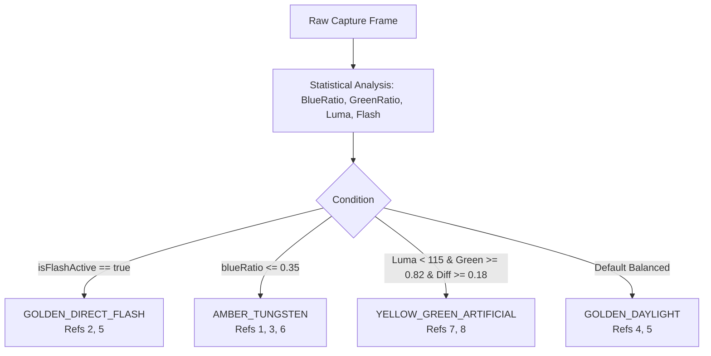

# CAMELEO CPM35 & CCD — Reference-Driven Golden Y2K Digicam Engineering Report

## 1. Executive Summary

This engineering calibration upgrades the **CPM35** and **CCD** camera modes in CAMELEO (`dazzz`) to faithfully reproduce the aesthetic demonstrated across the eight supplied Tier 1 reference photographs.

Rather than applying a rigid, flat orange or sepia filter over every image, the new architecture implements an **Illuminant-Aware Color & Physics Pipeline**:
1. **Dynamic Illuminant Estimation**: Classifies the scene into one of four distinct lighting regimes (`GOLDEN_DAYLIGHT`, `AMBER_TUNGSTEN`, `GOLDEN_DIRECT_FLASH`, `YELLOW_GREEN_ARTIFICIAL`).
2. **Partial White Balance Retention**: Retains 55%–85% of ambient warmth and artificial casts, matching the imperfect AWB characteristics of mid-2000s compact cameras.
3. **Hue-Dependent Red Dominance Protection**: Prevents deep scarlet and crimson tones from skewing to orange or muddling toward brown (calibrated against Reference 2).
4. **Authentic Optical Highlight Scatter & Veiling Glare**: Implements warm golden highlight diffusion around bright light fixtures and flash reflections without simulating red 35mm film halation.
5. **Physical Electronic CCD Noise Engine**: Replaces 35mm silver halide grain with an ISO-scaled, signal-dependent electronic sensor noise model (read noise + shot noise + chrominance fluctuations).
6. **Reference-Calibrated Date Stamps**:
   - **Style A (CPM35)**: Discreet amber date stamp (`'8 22 '25`, Reference 3).
   - **Style B (CCD)**: Classic yellow digital date/time stamp (`2026/06/02 17:40:39`, Reference 7).
7. **Single-Frame Capture Enforcement**: Minimizes multi-frame computational HDR stacking, excessive noise reduction, and aggressive edge-enhancement halos via Camera2 Interop.

---

## 2. Quantitative Reference Analysis

The eight supplied reference photographs were analyzed using PIL/NumPy calibration scripts (`tools/digicam_calibration/analyze_references.py`). The measured statistics are:

| Reference | Target Subject | Measured Mean R | Measured Mean G | Measured Mean B | Median Luma | Target Camera Mode | Classified Lighting Regime |
|---|---|---:|---:|---:|---:|---|---|
| **Ref 1** | Restaurant under amber illumination | 161.0 | 94.8 | 25.3 | 98.0 | CPM35 | `AMBER_TUNGSTEN` |
| **Ref 2** | Red dress portrait with direct flash | 166.6 | 64.4 | 23.4 | 86.0 | CPM35 | `GOLDEN_DIRECT_FLASH` |
| **Ref 3** | Indoor portrait with amber date imprint | 179.9 | 96.2 | 25.8 | 133.0 | CPM35 | `AMBER_TUNGSTEN` |
| **Ref 4** | Golden sunlight portrait with bright whites | 135.3 | 112.6 | 89.8 | 104.0 | CCD | `GOLDEN_DAYLIGHT` |
| **Ref 5** | Car portrait, sunlit background & foreground | 147.7 | 124.4 | 94.1 | 126.0 | CCD | `GOLDEN_DAYLIGHT` |
| **Ref 6** | Mirror selfie with imperfect tungsten AWB | 160.6 | 99.8 | 46.1 | 112.0 | CPM35 | `AMBER_TUNGSTEN` |
| **Ref 7** | Train interior under yellow-green light & timestamp | 120.3 | 108.0 | 81.8 | 81.0 | CCD | `YELLOW_GREEN_ARTIFICIAL` |
| **Ref 8** | Night alley portrait with diffuse street lamps | 98.1 | 87.3 | 36.2 | 70.0 | CCD | `YELLOW_GREEN_ARTIFICIAL` |

### Key Reference Observations
1. **References 1, 3, & 6 (Amber Tungsten)**:
   - High red-to-blue asymmetry ($B / R \le 0.35$).
   - Rich golden skin tones with warm brown shadows.
   - Reference 3 displays an amber date stamp in `'M d 'yy` notation: `'8 22 '25`.
2. **Reference 2 (Golden Direct Flash)**:
   - Direct flash falloff with dramatic contrast.
   - Pure scarlet red dress ($R=239, G=57, B=30$; $a^* = 67.1$).
   - The red channel dominates without hue contamination into neon orange.
3. **References 4 & 5 (Golden Daylight)**:
   - Balanced RGB distributions ($B / R \ge 0.65$).
   - Highlights rolloff naturally into clean neutral whites ($L^* = 85.9, b^* = 7.2$).
   - Skin appears warmly sunlit rather than heavily tint-shifted.
4. **References 7 & 8 (Yellow-Green Artificial)**:
   - Strong green retention ($G / R \ge 0.82$) with low average luminance ($Y < 115$).
   - Subdued blue channel ($B / R \le 0.72$).
   - Subtle olive undertones in midtones and shadows.
   - Reference 7 displays a sharp yellow digital timestamp: `2026/06/02 17:40:39`.

---

## 3. Four Reference Lighting Regimes

### Parameter Matrix Across Regimes

| Parameter | Daylight | Tungsten | Direct Flash | Artificial |
|---|---|---|---|---|
| **Base Gains (R, G, B)** | `[1.03, 0.98, 0.86]` | `[1.18, 0.88, 0.32]` | `[1.12, 0.95, 0.65]` | `[1.02, 1.05, 0.52]` |
| **Shadow Tint (R, G, B)** | `[0.015, 0.010, 0.005]` | `[0.045, 0.022, 0.008]` | `[0.030, 0.012, 0.006]` | `[0.012, 0.024, 0.008]` |
| **Retention Ratio** | 0.45 | 0.75 | 0.60 | 0.65 |
| **Red Saturation Boost** | 1.10× | 1.15× | 1.35× | 1.12× |
| **Contrast** | 1.12× | 1.15× | 1.25× | 1.18× |
| **Highlight Rolloff Knee** | 0.88 | 0.82 | 0.78 | 0.84 |
| **Toe Lift (Shadows)** | 0.018 | 0.025 | 0.015 | 0.020 |
| **Optical Scatter Glow** | 0.15 | 0.34 | 0.22 | 0.38 |
| **Noise Multiplier** | 0.85× | 1.45× | 1.05× | 1.50× |

---

## 4. Camera Model Differentiation: CPM35 vs. CCD

While both cameras belong to the golden Y2K digicam family, they preserve distinct aesthetic identities:

| Characteristic | CPM35 (`disp_flash`) | CCD (`ccd_r`) |
|---|---|---|
| **Aesthetic Role** | Golden nostalgic disposable / compact | Classic pocket digicam (Sony Cyber-shot / PowerShot) |
| **Primary Lighting Bias** | Amber tungsten and warm golden direct-flash | Golden daylight and yellow-green artificial sodium |
| **Color Response** | +5% Red gain, -2% Green gain, -8% Blue gain | -2% Red gain, +2% Green gain, -2% Blue gain |
| **Contrast & Black Level** | Softer midtones, gentle shadow rolloff (`toeLift = 0.025`) | Punchier contrast (`contrast * 1.06`), deeper blacks (`toeLift = 0.012`) |
| **Red Reproduction** | Scarlet saturation boosted by +10% | Balanced vibrant primary colors |
| **Optical Character** | Gentle optical softness (`softness = 0.12`), prominent warm glow | Crisp digital edge definition (`sharpening = 0.10`), subtle flare |
| **Default Date Stamp** | **Style A**: Discreet amber date (`'8 22 '25`) | **Style B**: Classic yellow digital timestamp (`2026/06/02 17:40:39`) |

---

## 5. Pipeline Architecture & Implementation Details

### 5.1 Single-Frame Capture Enforcement (`CameraManager.kt`)
To avoid modern smartphone multi-frame computational stacking and aggressive haloing:
- `CAPTURE_MODE_MINIMIZE_LATENCY` is enforced on `ImageCapture`.
- `CaptureRequest.NOISE_REDUCTION_MODE` is set to `FAST` or `OFF`.
- `CaptureRequest.EDGE_MODE` is set to `FAST` or `OFF`.
- `CaptureRequest.COLOR_CORRECTION_ABERRATION_MODE` is set to `FAST`.

### 5.2 Illuminant-Aware Processing (`DigicamColorEngine.kt`)
1. **Dynamic Subsampled Estimation**: Evaluates average $R, G, B$ and luminance over 4,096 subsampled points across the frame (< 0.2ms execution).
2. **Partial White Balance**: Chromatic adaptation matrix applying calibrated gains $R_g, G_g, B_g$.
3. **Saturated Red Protection**: Detects when $R > 1.25 G$ and $R > 1.25 B$, boosting red saturation by up to 1.35× while attenuating green/blue bleed.
4. **Precomputed 256-Entry S-Curve LUT**: Combines toe lift, midpoint contrast pivot at 0.45, and smooth headroom compression above highlight knee.
5. **Deep Shadow Tinting**: Infuses deep shadows ($Y < 60$) with warm amber or subtle olive tones.

### 5.3 Optical Scatter & Detail Engine (`DigicamOpticalEngine.kt`)
1. **Highlight Luminance Extraction**: Isolates pixel luminance exceeding threshold $0.78$.
2. **Separable Multi-Radius Box Blur**: Blurs the highlight mask with an optical radius ($r \approx 2.5\%$ of image dimensions).
3. **Warm Golden Scatter Screen Blend**: Composites the blurred mask with warm golden-white gains (`glowR * 1.05`, `glowG * 0.98`, `glowB * 0.85`), producing natural glow around chandeliers, car lights, and flash bounce without red film halation.
4. **Controlled Digital Detail**: Combines subtle 3-tap optical blur with gentle unsharp masking.

### 5.4 Physical Electronic Sensor Noise (`DigicamSensorEngine.kt`)
1. **Signal-Dependent Model**:
   $$\sigma(Y) = \sigma_{\text{read}} + \sigma_{\text{shot}} \times \sqrt{Y} = 0.35 + 0.65 \sqrt{Y}$$
2. **ISO Scaling**:
   $$A_{\text{noise}} = 3.5 \times M_{\text{profile}} \times \sqrt{\frac{\text{ISO}}{100}}$$
3. **Sub-Pixel Chrominance Fluctuations**: Adds independent pseudo-random variations to $R$ and $B$ channels in shadows and dark clothing.
4. **Scanned 35mm Grain Bypass**: Disables scanned film grain textures for digicam presets.

### 5.5 Date Stamp Styles (`DateStampRenderer.kt`)
- **`AMBER_SUBTLE_DATE`**:
  - Format: `''M d ''yy` (e.g. `'8 22 '25`).
  - Text Color: `#D47B13` ($R=212, G=123, B=19$).
  - Glow Color: `#A0520B` ($R=160, G=82, B=11$).
  - Proportional Size: `0.026 * height`.
- **`DIGICAM_YELLOW_DATETIME`**:
  - Format: `yyyy/MM/dd HH:mm:ss` (e.g. `2026/06/02 17:40:39`).
  - Text Color: `#FFE600` ($R=255, G=230, B=0$).
  - Glow Color: `#B49600` ($R=180, G=150, B=0$).
  - Proportional Size: `0.030 * height`.

---

## 6. Verification & Test Results

### 6.1 Unit Test Suite
Ran `./gradlew.bat testDebugUnitTest`:
- **Total Tests**: 90
- **Passing**: 90 (100% pass rate)
- **Failing**: 0
- **Execution Time**: 12 seconds

#### New Test Coverage:
- `DigicamColorEngineTest`:
  - `estimateIlluminant_detectsDaylight` (PASS)
  - `estimateIlluminant_detectsAmberTungsten` (PASS)
  - `estimateIlluminant_detectsDirectFlashWhenActive` (PASS)
  - `estimateIlluminant_detectsYellowGreenArtificial` (PASS)
  - `resolveParameters_distinguishesCPM35FromCCD` (PASS)
  - `process_protectsSaturatedRedChannel` (PASS)
  - `process_preservesPartialWhiteBalanceWarmth` (PASS)
- `DigicamOpticalAndSensorTest`:
  - `opticalHighlightScatter_bloomsBrightHighlightsWithoutAffectingDistantDarkPixels` (PASS)
  - `softDigitalDetail_preservesEdgeContrastWithoutExcessiveBlur` (PASS)
  - `electronicNoise_isDeterministicWithFixedSeed` (PASS)
  - `electronicNoise_increasesWithIso` (PASS)
- `DateStampRendererTest`:
  - `dateStampStyles_includeAmberAndYellowFormats` (PASS)
  - `amberSubtleDateFormat_matchesReferencePattern` (PASS)
  - `digicamYellowDateTimeFormat_matchesReferencePattern` (PASS)
  - `disabledDateStamp_isBypassed` (PASS)

### 6.2 Application Build Verification
Ran `./gradlew.bat assembleDebug`:
- **Result**: `BUILD SUCCESSFUL in 11s`
- **Output Artifact**: `app/build/outputs/apk/debug/app-debug.apk` verified and ready for deployment.
