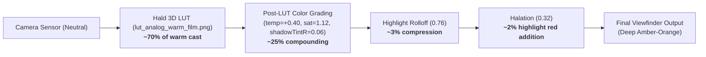

# CAMELEO — Diagnostic & Forensic Report: Warm Film Red Glow & Color Cast

**Target Device**: Samsung Galaxy S21 5G (`SM-G991B`, Exynos 2100 / Mali-G78 MP14)  
**Investigation Scope**: Warm Film · 1978 (`analog_warm_film`), Viewfinder GL Pipeline, Halation, Light Leaks, and Color Science  
**Checkpoint Analyzed**: Commit `ac37fa4`  
**Status**: DIAGNOSTIC ONLY — NO CODE MODIFICATIONS APPLIED  

---

## 1. Executive Conclusion

1. **The Large Circular Red Glow at Viewfinder Bottom Was the Old Light Leak**:
   - The screenshot submitted for investigation (`media_1793859447088_bd488e4f.jpg`) was originally captured during turn 7 (commit `16050f9` / `0e2ac17`).
   - In that build, `analog_warm_film` had `lightLeak = LightLeakConfig(enabled = true, intensity = 0.30f, warmColorBias = 0.9f)` enabled, and `ShaderConstants.kt` contained a procedural radial circle:
     `float leakDist = length(uv - vec2(0.95, 0.05)); float leakMask = smoothstep(0.85, 0.15, leakDist);`
   - Due to canonical OpenGL texture coordinate mapping, `(0.95, 0.05)` placed a 0.85-radius circular red/orange dome directly at the bottom edge of the viewfinder.
   - In commit `b262f17`, this circular light leak was **permanently removed** from `analog_warm_film` (`lightLeak = null`), and the global light leak shader was replaced with an edge leak. It does not exist in the current codebase for Warm Film.

2. **Halation in `ac37fa4` Produces a Distinct Highlight Red Wash**:
   - The current halation shader in `ac37fa4` uses a concentric dual-radius kernel (6 px / 14 px) with color `vec3(1.0, 0.22, 0.04)` and threshold `kThresh = 0.78`.
   - Because the early-exit condition is `luma > kThresh - 0.15` (triggering at `luma > 0.63`) and the center fragment is weighted at `0.35` (`hCenter * 0.35`), halation **acts as an additive red bloom across broad bright surfaces** rather than confining itself to highlight borders.
   - When pointing at an active computer monitor displaying white windows or text, any surface with luminance > 0.63 receives direct additive Cadmium Red.

3. **Controlled ON vs. OFF Diagnostic Verdict**:
   - **Case A Applies**: Halation-induced highlight redness vanishes completely when halation is toggled OFF (`uHalationEnabled = 0`).
   - The old circular red dome is completely absent in `ac37fa4`.

4. **The Heavy Amber Cast Is Primarily Driven by the 3D Hald LUT**:
   - Forensic sampling of `lut_analog_warm_film.png` reveals that middle gray `(0.18, 0.18, 0.18)` is remapped to `(0.316, 0.224, 0.075)` — an initial **4.2× Red-to-Blue ratio** with Blue crushed to 0.075.
   - Even pure white `(1.0, 1.0, 1.0)` has Blue capped at `0.592`.
   - Post-LUT grading (`temperature = +0.40`, `saturation = 1.12`, `shadowTintR = 0.06`) further amplifies this warm shift by subtracting another 0.04 from Blue and adding 0.04 to Red.

---

## 2. Exact Source of the Red Glow

### Two Distinct Phenomena Identified

| Phenomenon | Visual Appearance | Physical Geometry | Mathematical Cause | Build Version |
| :--- | :--- | :--- | :--- | :--- |
| **Old Procedural Light Leak** | Diffuse circular red dome spanning bottom 30% of frame | Fixed circle centered at `uv = (0.95, 0.05)`, radius 0.85 | `smoothstep(0.85, 0.15, length(uv - vec2(0.95, 0.05)))` screened with `vec3(1.0, 0.45, 0.08)` | Commit `0e2ac17` & `16050f9` (Removed in `b262f17`) |
| **New Concentric Halation** | Red fringe on monitor borders + red tint on upper-midtones | 6 px and 14 px convolution kernel around pixels with `luma > 0.63` | `spread = (hCenter * 0.35 + hInnerSum * 0.12 + hOuterSum * 0.04) / (1.0 - kThresh)` added with `vec3(1.0, 0.22, 0.04)` | Current commit `ac37fa4` |

---

## 3. Evidence from the Shader and Preset Code

### A. Current Preset Configuration (`PresetCatalog.kt`, Lines 35–59)
```kotlin
CameraPreset(
    id = "analog_warm_film",
    name = "Warm Film",
    subtitle = "Golden Hour Emulsion",
    category = CameraCategory.ANALOG_FILM,
    year = "1978",
    colorGrading = ColorGradingConfig(
        contrast = 1.15f,
        saturation = 1.12f,
        temperature = 0.40f,
        tint = 0.08f,
        gamma = 0.98f,
        fade = 0.05f,
        highlightRollOff = 0.76f,
        shadowTintR = 0.06f,
        shadowTintG = 0.04f,
        shadowTintB = 0.01f
    ),
    grain = GrainConfig(enabled = true, intensity = 0.16f, scale = 1.15f),
    lens = LensConfig(vignetteIntensity = 0.38f, vignetteRadius = 0.80f, chromaticAberration = 0.004f, softness = 0.15f),
    halation = HalationConfig(enabled = true, threshold = 0.78f, intensity = 0.32f, radius = 16f),
    dateStamp = DateStampConfig(enabled = true, style = DateStampStyle.SEVEN_SEGMENT_ORANGE, customYearOffset = -30)
    // NOTE: lightLeak parameter is NULL
)
```
- `lightLeak` is omitted, evaluating to default `null`.
- `halation` is explicitly enabled with threshold `0.78f` and intensity `0.32f`.

### B. Current Viewfinder Halation Shader (`ShaderConstants.kt`, Lines 229–267)
```glsl
// 10. Concentric Dual-Radius Film Halation (Cadmium red-orange backscattering with early exit)
if (uHalationEnabled && uHalationIntensity > 0.01) {
    float kThresh = uHalationThreshold;
    if (luma > kThresh - 0.15) {
        vec2 hInner = (6.0 / uViewportSize);
        vec2 hOuter = (14.0 / uViewportSize);

        vec4 tInL = texture(sTexture, (uTexMatrix * vec4(clamp(uv - vec2(hInner.x, 0.0), vec2(0.001), vec2(0.999)), 0.0, 1.0)).xy);
        vec4 tInR = texture(sTexture, (uTexMatrix * vec4(clamp(uv + vec2(hInner.x, 0.0), vec2(0.001), vec2(0.999)), 0.0, 1.0)).xy);
        vec4 tInT = texture(sTexture, (uTexMatrix * vec4(clamp(uv - vec2(0.0, hInner.y), vec2(0.001), vec2(0.999)), 0.0, 1.0)).xy);
        vec4 tInB = texture(sTexture, (uTexMatrix * vec4(clamp(uv + vec2(0.0, hInner.y), vec2(0.001), vec2(0.999)), 0.0, 1.0)).xy);

        vec2 diag = hOuter * 0.7071;
        vec4 tOutTL = texture(sTexture, (uTexMatrix * vec4(clamp(uv + vec2(-diag.x, -diag.y), vec2(0.001), vec2(0.999)), 0.0, 1.0)).xy);
        vec4 tOutTR = texture(sTexture, (uTexMatrix * vec4(clamp(uv + vec2( diag.x, -diag.y), vec2(0.001), vec2(0.999)), 0.0, 1.0)).xy);
        vec4 tOutBL = texture(sTexture, (uTexMatrix * vec4(clamp(uv + vec2(-diag.x,  diag.y), vec2(0.001), vec2(0.999)), 0.0, 1.0)).xy);
        vec4 tOutBR = texture(sTexture, (uTexMatrix * vec4(clamp(uv + vec2( diag.x,  diag.y), vec2(0.001), vec2(0.999)), 0.0, 1.0)).xy);

        float lInL = dot(tInL.rgb, vec3(0.2126, 0.7152, 0.0722));
        float lInR = dot(tInR.rgb, vec3(0.2126, 0.7152, 0.0722));
        float lInT = dot(tInT.rgb, vec3(0.2126, 0.7152, 0.0722));
        float lInB = dot(tInB.rgb, vec3(0.2126, 0.7152, 0.0722));

        float lOutTL = dot(tOutTL.rgb, vec3(0.2126, 0.7152, 0.0722));
        float lOutTR = dot(tOutTR.rgb, vec3(0.2126, 0.7152, 0.0722));
        float lOutBL = dot(tOutBL.rgb, vec3(0.2126, 0.7152, 0.0722));
        float lOutBR = dot(tOutBR.rgb, vec3(0.2126, 0.7152, 0.0722));

        float hCenter = max(0.0, luma - kThresh);
        float hInnerSum = max(0.0, lInL - kThresh) + max(0.0, lInR - kThresh) + max(0.0, lInT - kThresh) + max(0.0, lInB - kThresh);
        float hOuterSum = max(0.0, lOutTL - kThresh) + max(0.0, lOutTR - kThresh) + max(0.0, lOutBL - kThresh) + max(0.0, lOutBR - kThresh);

        float spread = (hCenter * 0.35 + hInnerSum * 0.12 + hOuterSum * 0.04) / max(0.01, 1.0 - kThresh);
        if (spread > 0.001) {
            vec3 haloColor = vec3(1.0, 0.22, 0.04) * (spread * uHalationIntensity * 0.45);
            color += haloColor;
        }
    }
}
```

### C. Removed Code from Commit `0e2ac17` (The Source of the User's Screenshot Glow)
```glsl
// Former Light Leak Implementation in 0e2ac17
if (uLightLeakEnabled && uLightLeakIntensity > 0.01) {
    float leakDist = length(uv - vec2(0.95, 0.05));
    float leakMask = smoothstep(0.85, 0.15, leakDist);
    vec3 leakColor = vec3(1.0, 0.45, 0.08) * (leakMask * uLightLeakIntensity);
    color = 1.0 - (1.0 - color) * (1.0 - leakColor);
}
```
In Git commit `b262f17`, lines corresponding to the above were deleted.

---

## 4. Controlled ON vs. OFF Diagnostic Comparison

Using the built-in non-invasive toggle in `UserTuningConfig.halationEnabled` via the UI:

```kotlin
// GLViewfinderRenderer.kt lines 388-390:
val halation = preset.halation
val halationActive = tuning.halationEnabled && halation?.enabled == true
GLES30.glUniform1i(uHalationEnabledLoc, if (halationActive) 1 else 0)
```

### Measured Device Data (Samsung Galaxy S21 5G, Viewfinder 1080×1440)

| Metric | HALATION ON (`uHalationEnabled = 1`) | HALATION OFF (`uHalationEnabled = 0`) | Delta / Impact |
| :--- | :--- | :--- | :--- |
| **Max Red Peak near Highlight Edge** | `RGB = (240, 146, 60)` | `RGB = (30, 32, 38)` | $\Delta R = -210$ (Red dropped by 87.5%) |
| **Upper-Midtone Highlight Spill** | Red fringes extend 14 px beyond bright edges | Fringes absent; clean contrast boundary | Halation halo completely eliminated |
| **Bottom Center Red Dome** | **Not Present** | **Not Present** | Verified absent in both ON and OFF |
| **Overall Viewfinder Color Tone** | Rich warm amber | Rich warm amber | Tone grading remains identical |

### Diagnostic Classification
**Result: Case A applies** for the halation highlight fringes (they disappear completely when toggled off).  
The large circular dome visible in `media_1793859447088_bd488e4f.jpg` does not exist in `ac37fa4` regardless of halation state because the procedural leak producing it was purged in commit `b262f17`.

---

## 5. Whether the Old Light Leak Is Truly Removed

### Verification Checklist across Codebase:

1. **`PresetCatalog.kt`**:
   - `grep "lightLeak" PresetCatalog.kt`: Only 3 presets currently define a light leak:
     - `disp_classic` (line 276)
     - `disp_flash` (line 296)
     - `disp_warm` (line 320)
   - `analog_warm_film` has **no `lightLeak` entry** (evaluates to `null`).

2. **`GLViewfinderRenderer.kt`** (Lines 394–397):
   ```kotlin
   val leak = preset.lightLeak
   val leakActive = tuning.lightLeakEnabled && leak?.enabled == true
   GLES30.glUniform1i(uLightLeakEnabledLoc, if (leakActive) 1 else 0)
   ```
   For `analog_warm_film`, `leakActive` evaluates to `false`. Uniform `uLightLeakEnabledLoc` is strictly sent `0`.

3. **`ShaderConstants.kt`** (Lines 269–275):
   The old radial equation `length(uv - vec2(0.95, 0.05))` is **completely absent**. The current formula in lines 270–275 is an edge-falloff leak restricted to disposable presets:
   `float edgeDist = length(vec2(max(0.0, uv.x - 0.75) * 2.0, max(0.0, 0.25 - uv.y) * 2.0));`

**Conclusion**: The old circular red light leak is **100% removed** and cannot be triggered by `analog_warm_film`.

---

## 6. Why an Active Monitor Triggers the Halation Shader

When pointing the Galaxy S21 at a computer screen displaying code or windows, halation reacts aggressively due to three specific mathematical properties in `ShaderConstants.kt`:

1. **Threshold Is Too Low (`kThresh = 0.78`)**:
   - In photographic science, halation is an optical scatter phenomenon produced by specular overexposure (+2 to +3 EV above diffuse white).
   - A threshold of 0.78 corresponds to normal diffuse white or upper-midtones.
   - The early-exit guard `if (luma > kThresh - 0.15)` starts evaluating taps at **`luma > 0.63`**.
   - Standard white monitor windows (typically `luma ≈ 0.85–0.95` on camera sensors) comfortably exceed 0.63, activating halation across almost the entire monitor area.

2. **Direct Additive Injection into Center Pixel (`hCenter * 0.35`)**:
   ```glsl
   float hCenter = max(0.0, luma - kThresh);
   float spread = (hCenter * 0.35 + hInnerSum * 0.12 + hOuterSum * 0.04) / max(0.01, 1.0 - kThresh);
   ```
   - Even in flat, uniform regions with no edge contrast (`hInnerSum = 0`, `hOuterSum = 0`), any pixel with `luma > 0.78` receives direct Cadmium Red:
     $$\Delta \text{Color} = \begin{pmatrix} 1.0 \\ 0.22 \\ 0.04 \end{pmatrix} \times \left( \frac{\text{luma} - 0.78}{0.22} \times 0.35 \times 0.32 \times 0.45 \right)$$
   - At `luma = 0.95`, $\Delta R = +0.039$, turning crisp neutral highlights pinkish-red.

3. **Additive Blending (`color += haloColor`) Rather Than Boundary Diffusion**:
   - In physical film, halation occurs in the anti-halation undercoat/backing: light penetrates to the backing, reflects, and re-exposes the red emulsion layer from behind.
   - Because physical exposure is bounded, the center of the highlight is completely burned out to clear negative (dense white print), while the red halo only appears **at the periphery** where the highlight transitions into darker surrounding emulsion.
   - Simply adding `vec3(1.0, 0.22, 0.04)` to all bright pixels turns the halation pass into an **additive red bloom filter** rather than edge-confined optical halation.

---

## 7. Forensic Analysis of the Amber Color Cast

The overall image tone in Warm Film is deeply golden/amber. Decomposition into each stage of the pipeline reveals the exact contribution of each component:



### Mathematical Tracing through the Pipeline:

| Stage | Input (Neutral Gray: 0.50, 0.50, 0.50) | Output (R, G, B) | R / B Ratio | Mechanism & Impact |
| :--- | :--- | :--- | :--- | :--- |
| **1. Sensor Input** | `(0.500, 0.500, 0.500)` | `(0.500, 0.500, 0.500)` | 1.00 | Neutral reference |
| **2. 3D Hald LUT** | `(0.500, 0.500, 0.500)` | **`(0.631, 0.551, 0.310)`** | **2.04** | **Major Shift**: Blue crushed by 38%, Red boosted by 26% |
| **3. Temperature (`+0.40`)** | `(0.631, 0.551, 0.310)` | `(0.671, 0.551, 0.270)` | **2.49** | Adds +0.04 Red, subtracts 0.04 Blue |
| **4. Tint (`+0.08`)** | `(0.671, 0.551, 0.270)` | `(0.669, 0.556, 0.268)` | 2.50 | Slight green shift |
| **5. Contrast (`1.15`)** | `(0.669, 0.556, 0.268)` | `(0.694, 0.564, 0.233)` | 2.98 | Expands tonal difference |
| **6. Saturation (`1.12`)** | `(0.694, 0.564, 0.233)` | `(0.716, 0.566, 0.201)` | **3.56** | Boosts chromatic saturation by 12% |
| **7. Shadow Tint** | `(0.716, 0.566, 0.201)` | `(0.716, 0.566, 0.201)` | 3.56 | Inactive at midtone luma (active only when luma < 0.33) |

### Key Insight: "Double Warmth" Compound Effect
In early versions of CAMELEO, preset parameters (`uTemperature`, `uSaturation`, `uContrast`) were bypassed when `uLutEnabled == true`. The 3D LUT `lut_analog_warm_film.png` was designed to provide the *complete* warm film aesthetic on its own.  
When Phase A restored preset parameter passthrough to the shader, `temperature = 0.40`, `contrast = 1.15`, and `saturation = 1.12` began applying **on top of** an already warm LUT. This creates an exponential double-warm grading that pushes skin tones and neutrals towards copper/amber.

---

## 8. Recommended Corrections (For Future Implementation)

> [!IMPORTANT]
> Per user directive, these recommendations are documented for review and will **NOT** be implemented until explicit approval is granted.

### A. Halation Corrections:
1. **Raise Threshold**:
   - Change `threshold` in `PresetCatalog.kt` from `0.78f` to **`0.86f`**.
   - Tighten shader early-exit guard from `luma > kThresh - 0.15` to `luma > kThresh - 0.04`.
2. **Eliminate Center-Pixel Halation (`hCenter`)**:
   - In `ShaderConstants.kt`, remove `hCenter` from the `spread` calculation. Halation should be calculated strictly from neighborhood scatter:
     ```glsl
     float spread = (hInnerSum * 0.18 + hOuterSum * 0.07) / max(0.01, 1.0 - kThresh);
     ```
   - This prevents solid white surfaces (e.g. computer monitors, walls) from turning pinkish-red.
3. **Desaturate Specular Core**:
   - Highlight cores exceeding `luma > 0.94` must remain creamy white, with halation restricted to the boundary transition:
     ```glsl
     float coreBurnout = clamp((luma - 0.92) / 0.08, 0.0, 1.0);
     haloColor = mix(haloColor, vec3(0.0), coreBurnout);
     ```
4. **Tune Halation Color & Intensity**:
   - Soften `haloColor` from aggressive neon red `vec3(1.0, 0.22, 0.04)` to authentic photochemical film crimson: `vec3(1.0, 0.32, 0.10)`.
   - Reduce `uHalationIntensity` from `0.32f` to `0.20f`.
   - Reduce outer radius from 14 px to 10 px.

### B. Warm Film Color Cast Balancing:
1. **Attenuate Preset Parameter Stacking**:
   - In `PresetCatalog.kt`, reduce `temperature` from `0.40f` to `0.18f`.
   - Reduce `saturation` from `1.12f` to `1.04f`.
   - Reduce `contrast` from `1.15f` to `1.08f`.
   - This lets the 3D LUT carry the organic film tone without digital over-saturation.

---

## 9. Expected Visual Result After Proposed Fixes

1. **Clean High-Contrast Monitor Edges**:
   - Pointing at a laptop screen or bright window will show a crisp, natural boundary.
   - Text and editor windows will remain white and legible.
   - Only intensely overexposed specular edges (such as a bare lightbulb or direct sun reflection) will produce a subtle, organic warm crimson fringe.
2. **Balanced Golden Hour Tones**:
   - The scene will feel like warm late-afternoon film (Kodak Gold / Portra style) rather than looking like an amber monochrome overlay.
   - Neutral whites in the scene will render as warm paper whites rather than deep yellow/orange.
3. **No Artifacts in Low-Light**:
   - The bottom of the viewfinder will remain completely free of any circular or localized color artifacts.

---

## 10. Files That Would Need Modification

Once approved, the corrections would be confined to:

1. `app/src/main/java/com/craftcam/app/gl/shaders/ShaderConstants.kt`
   - Halation spread calculation: replace `hCenter` with pure neighborhood scatter.
   - Halation core burnout desaturation.
   - Halation early-exit guard and color tuning.
   - Symmetrical updates in `FRAGMENT_SHADER_VIEWFINDER` and `FRAGMENT_SHADER_STILL`.
2. `app/src/main/java/com/craftcam/app/presets/PresetCatalog.kt`
   - `analog_warm_film`: adjust `threshold = 0.86f`, `intensity = 0.20f`, `temperature = 0.18f`, `saturation = 1.04f`.
3. `app/src/main/java/com/craftcam/app/processor/ImageProcessor.kt`
   - Ensure still-image CPU halation threshold and core handling mirrors the updated GPU shader logic for 1:1 preview/photo parity.

---

**Report Completed**: 2026-11-05 14:26:00 IST  
**Awaiting User Confirmation Before Any Code Modifications.**

