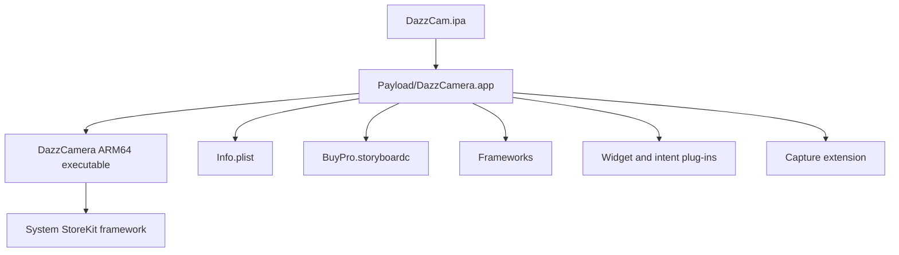

# Dazz Cam IPA — In-App Purchase Security Audit

## 1. Executive Summary

The supplied Dazz Cam 2.17.7 build 4 imports StoreKit 2 purchase and entitlement APIs and two StoreKit 1 classes. The package also contains a Pro purchase storyboard. These observations establish which interfaces the build references. The encrypted executable region and the absence of runtime or backend evidence leave the active purchase flow, verification decisions, and premium authorization boundaries unverified. No implementation weakness met the evidence threshold for confirmation.

## 2. Application Overview

| Field | Observed value |
|---|---|
| Input | `C:\Users\User\Downloads\DazzProject\DazzCam.ipa` |
| SHA-256 | `dd5e404371b340a341bb71b1c33b2c5aba281ecec86db8a6fb591c92ed75310c` |
| Size and ZIP entries | 133,853,281 bytes, 936 entries including directories |
| Bundle identifier | `dazz.camera.vintagecamera` |
| Version and build | 2.17.7, build 4 |
| Deployment target and SDK label | iOS 16.0 minimum, `iphoneos27.0` in `DTSDKName` |
| Main executable | `Payload/DazzCamera.app/DazzCamera`, ARM64 Mach-O |

## 3. IPA Package Analysis

Selected ZIP members were read directly. The main plist, Mach-O load commands and imports, and embedded XML signing entitlement slot were parsed. The following diagram shows package containment and the observed StoreKit linkage.



Paths below are relative to `Payload/DazzCamera.app/`.

| Component | Package evidence |
|---|---|
| Main app | `Info.plist`, `DazzCamera`, `_CodeSignature/CodeResources`, `SC_Info/` |
| Embedded frameworks | `Frameworks/DZImageFilter.framework`, `Frameworks/FirebaseAnalytics.framework`, `Frameworks/GoogleAppMeasurement.framework`. The main executable directly links DZImageFilter and also links system AVFoundation, WebKit, Security, SQLite, and Swift libraries, among others. |
| Plug-ins and extensions | `PlugIns/dazzWidgetIntent.appex/dazzWidgetIntent`, `PlugIns/dazzWidgetExtension.appex/dazzWidgetExtension`, `Extensions/dazzCaptureExtension.appex/dazzCaptureExtension`. Each has a bundle plist and resource signature manifest. |
| Language metadata | Main Mach-O contains the section-name markers `__objc_methname` and `__swift5_types`, Objective-C imports, and mangled Swift imports. |
| Signing and encryption | Main Mach-O has an embedded code-signature superblob with XML and DER entitlement slots. The XML slot lists `application-identifier`, `com.apple.developer.team-identifier`, and `com.apple.security.application-groups`. These are OS signing claims. Cryptographic signature validity and extension entitlement values were outside this inspection. No `embedded.mobileprovision` member was listed. `LC_ENCRYPTION_INFO_64` reports `cryptid = 1` and a 23,298,048-byte protected range. |
| Network policy | Main `Info.plist` sets `NSAppTransportSecurity.NSAllowsArbitraryLoads` to false and lists no ATS exceptions. The three extension root plists showed no ATS dictionary. This is configuration evidence. Request routing, trust handling, and purchase data transmitted were unobserved. |
| Purchase resources | `BuyPro.storyboardc/Info.plist`, `BuyPro.storyboardc/dc_pro_controller.nib`, and `BuyPro.storyboardc/dc_promotion_controller.nib` are present. No `.storekit` archive member was listed. Product types and catalog assignments remain unknown. |

## 4. Identified Purchase Frameworks

The main executable loads `/System/Library/Frameworks/StoreKit.framework/StoreKit`. The following references were read from undefined entries in its Mach-O symbol table.

| Interface | Observed evidence | Confidence and interpretation |
|---|---|---|
| StoreKit 2 | `_$s8StoreKit11TransactionV19currentEntitlementsAC12TransactionsVvgZ`, `_$s8StoreKit11TransactionV7updatesAC12TransactionsVvgZ` | High for the imports. Their execution and verification handling are unresolved. |
| StoreKit 2 purchase | `_$s8StoreKit7ProductV8purchase7optionsAC14PurchaseResultOShyAC0F6OptionVG_tYaKF` and its async companion | High for an import of `Product.purchase(options:)`. Active routing is unresolved. |
| StoreKit 1 | `_OBJC_CLASS_$_SKPaymentQueue` and `_OBJC_CLASS_$_SKProductsRequest` | High for class imports. A legacy path, compatibility feature, or unrelated queue usage is possible. `SKPaymentTransaction` was not identified in the main executable marker scan. |
| Restoration and app transaction | Direct evidence for `AppStore.sync()` and `AppTransaction` was not identified in the inspected symbols and markers. | Insufficient to determine restoration behavior or whether either API is used. |
| Third-party or custom services | No separately embedded purchase framework was apparent among the three framework bundles. A limited main-executable scan found no RevenueCat, Adapty, Qonversion, Purchasely, verifyReceipt, or api.storekit markers. | Low confidence in any inference about actual services. Static linkage, indirect calls, encryption, and server-side integration remain possible. |

## 5. In-App Purchase Workflow

The first column describes a plausible workflow for this build. The final two columns distinguish the evidence from the open questions.

| Stage | Package evidence | Open question |
|---|---|---|
| User selects a premium option | Compiled Pro and promotion UI exists. | Which camera, lens, effect, or mode enters this flow? |
| App resolves the product | StoreKit 1 product request class is imported. | Which path loads the live catalog and handles unavailable products? |
| App requests payment | StoreKit 2 purchase method is imported. | Which path calls it and handles cancellation or pending results? |
| Apple returns a transaction | StoreKit 2 transaction interfaces are present. | How does the app process the purchase result? |
| App or server validates ownership | No verified decision path observed. | Where are authenticity, state, and account binding checked? |
| App derives and applies access | No verified product-to-feature mapping observed. | What component grants access and which entry points consult it? |
| App refreshes access | Current entitlements and update stream are imported. | When do refresh and restoration run, and how do they remove stale access? |

## 6. Premium Lens and Camera Entitlement Architecture

| Component and location | Evidence and possible responsibility | Trust boundary and concern | Confidence |
|---|---|---|---|
| Pro UI, `BuyPro.storyboardc/` | NIB names identify Pro and promotion surfaces. They may display offers. | UI state is a presentation concern. Review access at feature execution in the owner build. | High for artifact, low for behavior |
| Transaction interfaces, `DazzCamera` | Current entitlements, updates and purchase imports may support a purchase lifecycle. | StoreKit verification result to app policy. Verify every grant consumes authenticated state. | High for imports, unresolved for grants |
| App group, main executable signing blob | App-group capability is declared. | Main app and extension storage may share a container. Whether any purchase state crosses it remains unknown. | High for capability, unresolved for use |
| Camera, lens, filters, modes, and editing | Package UI and framework names do not establish per-feature commercial ownership. | Feature operations and any server APIs should consume one entitlement policy. | Insufficient |
| Backend, Keychain, UserDefaults, local and cached state | No purchase-specific storage or backend authority was established. | A local cache can support legitimate offline access. Assess its provenance, scope and freshness. | Insufficient |

## 7. Transaction Verification Assessment

The imports alone cannot establish handling of `VerificationResult.verified`, purchase-result errors, transaction finishing, or whether verification happens locally or on a server. The network settings establish the declared ATS defaults for the main bundle. They provide no direct observation of purchase endpoint authentication, transaction data disclosure, or authorization based on client claims.

An owner build should record decision outcomes using redacted test telemetry. Trace the same entitlement through purchase, app restart, restore, refund or revocation, account switching, and any extension that can invoke a premium operation. Correlate the client result with server decisions when a server participates.

## 8. Vulnerability Findings

**Confirmed implementation weaknesses:** None established by the inspected package evidence.

**Potential concerns requiring authorized validation:** These are review hypotheses. Severity is conditional on establishing the behavior and its impact.

| ID | Potential vulnerability | Evidence | Severity | Confidence | Recommended fix |
|---|---|---|---|---|---|
| V-01 | A feature entry point relies on UI or cached state alone | Pro storyboard and entitlement-related imports establish separate surfaces. Gate behavior is unavailable. | Medium if local access impact is demonstrated | Low | Centralize feature authorization and derive grants from verified state. |
| V-02 | Verification failure or account mismatch still produces a grant | Purchase and entitlement imports identify interfaces. Their result handling was unobserved. | Medium, potentially High for cross-account or server-side impact | Low | Require successful verification, recognized product mapping and applicable account binding before fulfillment. |
| V-03 | Access stays active after revocation, expiration, or account change | Updates and current entitlement imports exist. Refresh cadence and cache behavior are unknown. | Medium if persistent access is demonstrated | Low | Rebuild the entitlement set from current authoritative state and apply explicit offline freshness rules. |
| V-04 | A backend trusts client-reported purchase state or exposes transaction data | ATS settings are visible. Purchase endpoint presence and design are unverified. | High if an affected server-wide grant path is demonstrated | Low | Verify Apple-signed inputs on the server and enforce authorization on privileged service operations. Minimize transaction data in logs. |

**Insufficient evidence:** Active StoreKit 1 responsibilities, premium feature mapping, product types, restore behavior, incident impact, Keychain and UserDefaults usage, server ownership decisions, and transport behavior. No CVSS vector was assigned because exploitability and impact were unverified.

## 9. Security Risk Matrix

| Review area | Conditional impact | Validation priority | Owner evidence needed |
|---|---|---|---|
| Transaction authenticity and server account binding | Incorrect grants across identities or server resources | First | Purchase-result handling, verifier configuration, and authorized sandbox records |
| Premium entry-point consistency | Inconsistent or unearned access to local features | First | Source inventory and automated assertions for each entry point |
| Refund, revocation, expiration and offline retention | Stale access or paid customers losing access | First | Lifecycle transitions, cache schema and freshness rules |
| Restore, pending and interruptions | Duplicate fulfillment or inaccessible purchased features | Next | Test transaction timelines and retry outcomes |
| Network handling | Transaction data exposure or incorrect environment routing | Next | Endpoint inventory, redacted test traces and server logs |

## 10. Recommended Security Improvements

1. Use a central StoreKit 2 entitlement coordinator. Accept verified results for mapped products, observe updates at launch, and rebuild access when returning to the foreground. Treat cancellation and pending results as distinct states. Make delivery idempotent and finish transactions after durable fulfillment where needed. [Transaction updates](https://developer.apple.com/documentation/storekit/transaction/updates) · [Current entitlements](https://developer.apple.com/documentation/storekit/transaction/currententitlements)
2. Supply an account-scoped `appAccountToken` when applicable. For server-controlled benefits, verify Apple's signed transaction data, check app and environment identity, and bind accepted grants to the correct service account. Enforce access server-side. Use App Store Server API for reconciliation where backend authority or support workflows require it. [App Store Server API](https://developer.apple.com/documentation/appstoreserverapi)
3. Process App Store Server Notifications V2 with signed-payload verification and idempotent ingestion. Reconcile with authoritative transaction and subscription status after missed or conflicting events. Distinguish cancellation of auto-renewal from expiration, and withdraw access at the applicable revocation or expiration boundary. [App Store Server Notifications](https://developer.apple.com/documentation/appstoreservernotifications)
4. For local non-consumables, use verified current entitlements and expose a user-initiated restore action backed by `AppStore.sync()`. For server-backed offline access, scope cached decisions to the account and product, cap the stale window by policy and applicable expiry, and revalidate on reconnection. Protect account credentials in Keychain and keep editable preferences outside the authority chain. [AppStore.sync()](https://developer.apple.com/documentation/storekit/appstore/sync())
5. Apply one product-to-feature policy across camera, lens, capture, filter and editing entry points. Include widgets or extensions if they deliver gated functionality. Keep UI display state derived from that policy and keep sensitive transaction payloads out of routine analytics.

## 11. Secure StoreKit Reference Architecture

Independent Swift example for local, non-consumable features on iOS 16 or later. Product IDs are supplied by the host app. The example handles verified purchases, refresh, updates and restore. A service that delivers external or account-bound benefits needs its own verified, durable fulfillment before finishing a transaction. The example was not compiled in an iOS SDK in this assessment.

```swift
import StoreKit

@MainActor
final class NonConsumableAccess {
    enum PurchaseState { case purchased, pending, cancelled }
    enum PurchaseError: Error { case unexpectedProduct, unverified, unknownResult }

    private let productIDs: Set<String>
    private var granted: Set<String> = []
    private var generation = 0
    private var updates: Task<Void, Never>?

    init(productIDs: Set<String>) {
        self.productIDs = productIDs
    }

    deinit {
        updates?.cancel()
    }

    func start() async {
        if updates == nil {
            updates = Task { [weak self] in
                for await result in Transaction.updates {
                    guard let self else { return }
                    if case .verified(let transaction) = result,
                       self.recognizes(transaction) {
                        await self.refresh()
                        await transaction.finish()
                    }
                }
            }
        }
        await refresh()
    }

    func allows(_ productID: String) -> Bool {
        granted.contains(productID)
    }

    func refresh() async {
        generation += 1
        let request = generation
        var current: Set<String> = []
        for await result in Transaction.currentEntitlements {
            guard case .verified(let transaction) = result,
                  recognizes(transaction),
                  transaction.revocationDate == nil else { continue }
            current.insert(transaction.productID)
        }
        if request == generation {
            granted = current
        }
    }

    func purchase(_ product: Product) async throws -> PurchaseState {
        guard productIDs.contains(product.id), product.type == .nonConsumable else {
            throw PurchaseError.unexpectedProduct
        }
        switch try await product.purchase() {
        case .success(let result):
            guard case .verified(let transaction) = result else {
                throw PurchaseError.unverified
            }
            guard recognizes(transaction), transaction.productID == product.id,
                  transaction.revocationDate == nil else {
                throw PurchaseError.unexpectedProduct
            }
            await refresh()
            await transaction.finish()
            return .purchased
        case .pending:
            return .pending
        case .userCancelled:
            return .cancelled
        @unknown default:
            throw PurchaseError.unknownResult
        }
    }

    func restore() async throws {
        try await AppStore.sync()
        await refresh()
    }

    private func recognizes(_ transaction: Transaction) -> Bool {
        productIDs.contains(transaction.productID)
            && transaction.productType == .nonConsumable
    }
}
```

Retain the coordinator for the app lifecycle. Await initial loading before displaying an ownership decision, call refresh on foregrounding, and invoke restore from a user action. Feature execution reads the entitlement set, including after a purchase result. Subscription products need a separate policy for renewal states and grace periods.

## 12. Remediation Roadmap

Priorities reflect conditional impact and the evidence gap. Changes should follow owner validation of the affected path.

| Priority and issue | Why it matters and architectural change | Complexity | Authorized validation | Benefit |
|---|---|---|---|---|
| P0 — Authenticated grants | Incorrect grants can affect multiple identities. Trace and centralize verified ownership and product/account binding. | Medium to high | Assert verifier rejection and absence of a grant using owner-controlled unit fixtures. Check valid signed sandbox purchases end to end. | Reliable purchase authority |
| P0 — Gate consistency | Alternate entry points can produce divergent access. Route them through the same feature policy. | Medium | Exercise each premium operation with entitled and fresh sandbox users, including applicable extensions. | Consistent enforcement |
| P1 — Lifecycle and cache | State changes can leave stale grants or deny legitimate customers. Recompute access and establish a bounded offline policy. | Medium | Test refunds, revocations, subscription transitions if applicable, account changes, offline relaunch, and reconnect. | Timely convergence |
| P1 — Backend reconciliation if applicable | Duplicate, delayed, and missed events can create inconsistent grants. Verify and idempotently ingest V2 events and reconcile using the API. | High | Deliver sandbox notifications and exercise duplicate and delayed delivery through owner test infrastructure. Compare final state to Apple. | Durable and auditable fulfillment |
| P2 — Restore, errors and transport | Interrupted or cancelled flows can produce incorrect UI and grants. Handle explicit purchase states, restore, and privacy-safe telemetry. | Medium | Test cancellation, pending approval, restart during fulfillment, restore on another device, timeouts, and authorized endpoint/log review. | Recoverable failures and reduced data exposure |

## 13. Limitations and Further Testing

This is a read-only static package assessment from Windows. The app was neither executed nor decrypted. No production endpoints were probed, purchases attempted, or app files changed. Code-signature trust, executable call sites in protected regions, comprehensive framework symbol analysis, and backend behavior were unverified. A missing marker provides weak negative evidence because of encryption, compiler optimization, indirect references, and service-side implementation.

Use a developer-provided source build for call-site and entitlement data-flow review. Reproduce legitimate purchase states in StoreKit Testing in Xcode, then use sandbox or TestFlight for Apple-signed transactions and server-to-server integration. Check cold launch, restore on another device, account changes, pending approval, cancellation, refund, and offline behavior. Collect redacted evidence for each outcome and assign CVSS only to substantiated findings. [Apple testing environments](https://developer.apple.com/documentation/storekit/testing-at-all-stages-of-development-with-xcode-and-the-sandbox)

## 14. Final Conclusions

This IPA establishes StoreKit 2 purchase and entitlement imports, StoreKit 1 class references, a Pro purchase UI, and the declared main-bundle transport policy. The highest-priority unresolved question is whether every premium operation and any privileged backend action derive access from verified, correctly scoped, current ownership. Owner-controlled source review and sandbox evidence are needed to determine that.

